# *Berlin Waters*: An Inland Waterway Dataset for Multi-Sensor SLAM and Semantic Segmentation

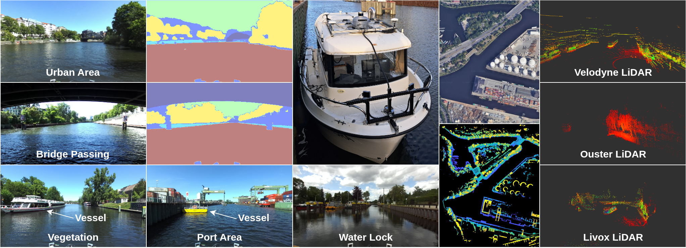

## Overview

*Berlin Waters* is a multimodal dataset collected on inland waterways in Berlin to support research in SLAM, perception, and semantic understanding.

## Dataset Highlights

- **22 scenes** (**11 train / 11 test**) spanning about **70 km** and **9 hours** on Berlin’s inland waterways
- **Diverse environments**: urban canals, ports, water locks, bridges, vegetation, and dynamic vessel traffic
- **Multi-sensor data** from Velodyne, Ouster, and Livox LiDARs, a stereo camera, IMU, and multi-antenna GNSS, stored as **ROS 2 bags** (SQLite3 `.db3` files)
- **Post-processed RTK-GNSS reference trajectories** together with raw GNSS observations in **RINEX format**
- **2,900** semantically annotated images across **seven classes**: sky, water, vegetation, bridge, vessel, river bank, and other

## Publication and Citation

Citation information will be provided soon.

## Contact

For questions, collaboration requests, or dataset access inquiries, please contact the authors at iulian.filip@dlr.de

## Sensor Setup

The data-collection platform "Aurora" measures 6.5 m long × 2.6 m wide × 2.8 m high and is equipped with the following sensors: 
- **LiDAR 1 (main LiDAR)** (Velodyne VLP32C, 10 Hz, HFOV 360°, VFOV 40°)
  - ROS 2 topic: `/VLP32/velodyne_points`
- **LiDAR 2** (Ouster OS0-128, 10 Hz, HFOV 360°, VFOV 90°)
  - ROS 2 topic: `/ouster/points`
- **LiDAR 3** (Livox Avia, 10 Hz, HFOV 70.4°, VFOV 77.2°)
  - ROS 2 topic: `/livox/lidar`
- **Stereo camera × 1** (StereoLabs ZED 2i, 1920×1080, 10 Hz, with IMU recorded at 400 Hz)
  - ROS 2 topics: `/zed/zed_node/left/image_rect_color/compressed`, `/zed/zed_node/right/image_rect_color/compressed`, `/zed/zed_node/imu/data`
- **IMU × 1** (xsens MTi-680G, 400 Hz, and 1 u-blox GNSS antenna connected to the xsens IMU (4 Hz))
  - ROS 2 topics: `/xsens/imu/data`, `/xsens/gnss`
- **u-blox GNSS antennas × 3** (connected to u-blox M8T EVK receivers (5 Hz))
  - ROS 2 topics: `/ublox_1/fix`, `/ublox_2/fix`, `/ublox_3/fix`
- **JAVAD GNSS receivers with roof-mounted geodetic antennas × 3** (raw GNSS observables, 2 Hz)
  - No ROS 2 topics; RINEX files (`.rnx` and `.obs`) are provided for each antenna
- **Sonar × 1** (stern-mounted, 0.1 Hz)
  - ROS 2 topic: `/water_depth`

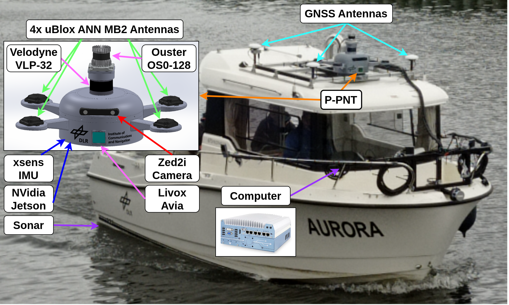


## Intrinsic and Extrinsic Parameters

The coordinates transformation between multiple sensors, and intrinsic parameters of camera are the same for all scenes and can be found via 
> <p style="color:red;">Link to Intrinsic and Extrinsic Parameters</p>

## Scene Overview

> <p style="color:red;">Access the dataset here. Link will be available soon.</p>

The following table summarizes date of collection, file size, the duration and traveled distance.
<!--
| Scene | Date of Collection | File Size | Duration [min] | Distance [km] | Velodyne LiDAR | Ouster LiDAR | Livox LiDAR | ZED 2i Camera | Xsens IMU | 3× u-blox | Xsens GNSS | 3× RINEX | Sonar | Description |
|:---|:---|:---|---:|---:|:---:|:---:|:---:|:---:|:---:|:---:|:---:|:---:|:---:|:---|
| `berlin_00` | May 22, 2025 | 21.5 GB | 10.3 | 1.42 | ✓ | ✗ | ✓ | ✓ | ✓ | ✓ | ✓ | ✓ | ✓ | Port area, bridge passage, loop closure |
| `berlin_01` | May 22, 2025 | 17.8 GB | 8.8 | 1.36 | ✓ | ✗ | ✓ | ✓ | ✓ | ✓ | ✓ | ✓ | ✓ | Port area, aggressive maneuvers, loop closure |
| `berlin_02` | May 22, 2025 | 34.9 GB | 17.0 | 2.26 | ✓ | ✗ | ✓ | ✓ | ✓ | ✓ | ✓ | ✓ | ✓ | Port area, loop closure, vessel traffic |
| `berlin_03` | May 22, 2025 | 41.2 GB | 19.7 | 2.67 | ✓ | ✗ | ✓ | ✓ | ✓ | ✓ | ✓ | ✓ | ✓ | Port and vegetation-dominated areas, loop closure, bridges |
| `berlin_04` | May 22, 2025 | 87.6 GB | 21.9 | 3.53 | ✓ | ✓ | ✓ | ✓ | ✓ | ✓ | ✓ | ✓ | ✓ | Vegetation-dominated area, loop closure |
| `berlin_05` | May 21, 2025 | 74.2 GB | 18.6 | 2.65 | ✓ | ✓ | ✓ | ✓ | ✓ | ✓ | ✓ | ✓ | ✓ | Urban area, bridge passage |
| `berlin_06` | May 22, 2025 | 48.9 GB | 12.3 | 0.42 | ✓ | ✓ | ✓ | ✓ | ✓ | ✓ | ✓ | ✓ | ✓ | Water lock entry and exit |
| `berlin_07` | May 20, 2025 | 115.4 GB | 28.8 | 1.00 | ✓ | ✓ | ✓ | ✓ | ✓ | ✓ | ✓ | ✓ | ✗ | Water lock entry and exit |
| `berlin_08` | May 21, 2025 | 14.7 GB | 6.7 | 0.51 | ✓ | ✗ | ✓ | ✓ | ✓ | ✓ | ✓ | ✓ | ✓ | Urban and vegetation-dominated areas, vessel traffic |
| `berlin_09` | May 21, 2025 | 16.0 GB | 7.3 | 0.87 | ✓ | ✗ | ✓ | ✓ | ✓ | ✓ | ✓ | ✓ | ✓ | Urban and vegetation-dominated areas, vessel traffic |
| `berlin_10` | May 20, 2025 | 371.5 GB | 88.4 | 11.94 | ✓ | ✓ | ✓ | ✓ | ✓ | ✓ | ✓ | ✓ | ✗ | Urban and vegetation-dominated areas, loop closure |
| `berlin_11` | May 22, 2025 | 27.7 GB | 13.7 | 1.96 | ✓ | ✗ | ✓ | ✓ | ✓ | ✓ | ✓ | ✓ | ✓ | Port area, loop closure, vessel traffic |
| `berlin_12` | May 22, 2025 | 29.1 GB | 13.9 | 1.85 | ✓ | ✗ | ✓ | ✓ | ✓ | ✓ | ✓ | ✓ | ✓ | Port and vegetation-dominated areas, loop closure, bridges |
| `berlin_13` | May 21, 2025 | 31.7 GB | 14.7 | 1.81 | ✓ | ✗ | ✓ | ✓ | ✓ | ✓ | ✓ | ✓ | ✓ | Narrow channel, bridge passage |
| `berlin_14` | May 21, 2025 | 42.6 GB | 19.8 | 2.79 | ✓ | ✗ | ✓ | ✓ | ✓ | ✓ | ✓ | ✓ | ✓ | Urban area, bridge passage |
| `berlin_15` | May 21, 2025 | 24.8 GB | 15.1 | 2.23 | ✓ | ✗ | ✗ | ✓ | ✓ | ✓ | ✓ | ✓ | ✓ | Vegetation-dominated area, vessel traffic, bridges |
| `berlin_16` | May 20, 2025 | 61.2 GB | 14.8 | 2.09 | ✓ | ✓ | ✓ | ✓ | ✓ | ✓ | ✓ | ✓ | ✗ | Urban and vegetation-dominated areas, vessel traffic, bridges |
| `berlin_17` | May 20, 2025 | 68.7 GB | 16.4 | 2.14 | ✓ | ✓ | ✓ | ✓ | ✓ | ✓ | ✓ | ✓ | ✗ | Port area, loop closure, bridges, vessel traffic |
| `berlin_18` | May 20, 2025 | 84.5 GB | 19.5 | 2.28 | ✓ | ✓ | ✓ | ✓ | ✓ | ✓ | ✓ | ✓ | ✗ | Narrow channel, vessel traffic, bridges |
| `berlin_19` | May 20, 2025 | 50.0 GB | 12.0 | 1.84 | ✓ | ✓ | ✓ | ✓ | ✓ | ✓ | ✓ | ✓ | ✗ | Urban and vegetation-dominated areas, vessel traffic, bridges |
| `berlin_20` | May 21, 2025 | 92.3 GB | 42.9 | 6.10 | ✓ | ✗ | ✓ | ✓ | ✓ | ✓ | ✓ | ✓ | ✓ | Port, urban, and vegetation-dominated areas, narrow channel |
| `berlin_21` | May 21, 2025 | 229.8 GB | 111.8 | 14.90 | ✓ | ✗ | ✓ | ✓ | ✓ | ✓ | ✓ | ✓ | ✓ | Urban and vegetation-dominated areas, loop closure |

**Legend:** ✓ available; ✗ unavailable.

-->

<!-- Scene summary table -->
<table>
  <thead>
    <tr><th>Set</th><th>Scene</th><th>Date of Collection</th><th>File Size</th><th>Duration [min]</th><th>Distance [km]</th></tr>
  </thead>
  <tbody>
    <tr><th rowspan="11" scope="rowgroup" style="border-bottom: 4px solid #6e7781;"></th><td><code>berlin_00</code></td><td>May 22, 2025</td><td>21.5 GB</td><td>10.3</td><td>1.42</td></tr>
    <tr><td><code>berlin_01</code></td><td>May 22, 2025</td><td>17.8 GB</td><td>8.8</td><td>1.36</td></tr>
    <tr><td><code>berlin_02</code></td><td>May 22, 2025</td><td>34.9 GB</td><td>17.0</td><td>2.26</td></tr>
    <tr><td><code>berlin_03</code></td><td>May 22, 2025</td><td>41.2 GB</td><td>19.7</td><td>2.67</td></tr>
    <tr><td><code>berlin_04</code></td><td>May 22, 2025</td><td>87.6 GB</td><td>21.9</td><td>3.53</td></tr>
    <tr><td><code>berlin_05</code></td><td>May 21, 2025</td><td>74.2 GB</td><td>18.6</td><td>2.65</td></tr>
    <tr><td><code>berlin_06</code></td><td>May 22, 2025</td><td>48.9 GB</td><td>12.3</td><td>0.42</td></tr>
    <tr><td><code>berlin_07</code></td><td>May 20, 2025</td><td>115.4 GB</td><td>28.8</td><td>1.00</td></tr>
    <tr><td><code>berlin_08</code></td><td>May 21, 2025</td><td>14.7 GB</td><td>6.7</td><td>0.51</td></tr>
    <tr><td><code>berlin_09</code></td><td>May 21, 2025</td><td>16.0 GB</td><td>7.3</td><td>0.87</td></tr>
    <tr><td style="border-bottom: 4px solid #6e7781;"><code>berlin_10</code></td><td style="border-bottom: 4px solid #6e7781;">May 20, 2025</td><td style="border-bottom: 4px solid #6e7781;">371.5 GB</td><td style="border-bottom: 4px solid #6e7781;">88.4</td><td style="border-bottom: 4px solid #6e7781;">11.94</td></tr>
    <tr><th rowspan="11" scope="rowgroup" style="border-bottom: 4px solid #6e7781;"></th><td><code>berlin_11</code></td><td>May 22, 2025</td><td>27.7 GB</td><td>13.7</td><td>1.96</td></tr>
    <tr><td><code>berlin_12</code></td><td>May 22, 2025</td><td>29.1 GB</td><td>13.9</td><td>1.85</td></tr>
    <tr><td><code>berlin_13</code></td><td>May 21, 2025</td><td>31.7 GB</td><td>14.7</td><td>1.81</td></tr>
    <tr><td><code>berlin_14</code></td><td>May 21, 2025</td><td>42.6 GB</td><td>19.8</td><td>2.79</td></tr>
    <tr><td><code>berlin_15</code></td><td>May 21, 2025</td><td>24.8 GB</td><td>15.1</td><td>2.23</td></tr>
    <tr><td><code>berlin_16</code></td><td>May 20, 2025</td><td>61.2 GB</td><td>14.8</td><td>2.09</td></tr>
    <tr><td><code>berlin_17</code></td><td>May 20, 2025</td><td>68.7 GB</td><td>16.4</td><td>2.14</td></tr>
    <tr><td><code>berlin_18</code></td><td>May 20, 2025</td><td>84.5 GB</td><td>19.5</td><td>2.28</td></tr>
    <tr><td><code>berlin_19</code></td><td>May 20, 2025</td><td>50.0 GB</td><td>12.0</td><td>1.84</td></tr>
    <tr><td><code>berlin_20</code></td><td>May 21, 2025</td><td>92.3 GB</td><td>42.9</td><td>6.10</td></tr>
    <tr><td style="border-bottom: 4px solid #6e7781;"><code>berlin_21</code></td><td style="border-bottom: 4px solid #6e7781;">May 21, 2025</td><td style="border-bottom: 4px solid #6e7781;">229.8 GB</td><td style="border-bottom: 4px solid #6e7781;">111.8</td><td style="border-bottom: 4px solid #6e7781;">14.90</td></tr>
  </tbody>
</table>

## Tools

Visualize *Berlin Waters* bags with `ros2 bag play` and our
[RViz visualizer](tools/visualization/ros2/README.md), which provides a sensor
layout and static transforms. A [Foxglove viewer](tools/visualization/foxglove/README.md)
is also available. Users without ROS 2 can inspect bags and extracted files
with [Rerun](tools/visualization/rerun/README.md). Use the
[data extractor](tools/extraction/README.md) to export camera images, LiDAR
point clouds, and IMU and GNSS data. The linked guides provide examples.

### Installation

Install Git, clone the repository, and run commands from its root directory:

```bash
sudo apt install git
git clone https://github.com/iulianfilip/berlin_waters.git
cd berlin_waters
```

**ROS 2 visualization:** ROS 2 Humble on Ubuntu 22.04, with `rosbag2`, `rviz2`,
`tf2_ros`, `compressed_image_transport`, and `python3-yaml`. Follow the
[RViz guide](tools/visualization/ros2/README.md) for installation and playback.
Foxglove additionally requires `foxglove_bridge` and Foxglove Desktop; see its
[guide](tools/visualization/foxglove/README.md).

**Rerun and extraction:** Python 3.10 and `python3-venv`. Install the Python
dependencies:

```bash
sudo apt install python3-venv
python3 -m venv .venv
.venv/bin/python -m pip install -r requirements-tools.txt
```

Use `.venv/bin/python` for Rerun and extraction. Pass the scene's bag directory
containing `metadata.yaml` and `.db3` files. See the [tools overview](tools/README.md)
for all scripts.

## Scene Details: Training Set

#### `berlin_00`

**Note:** This scene covers a port area with a bridge passing and a clear loop-closure opportunity. Ouster LiDAR data is unavailable.

<p align="center">
  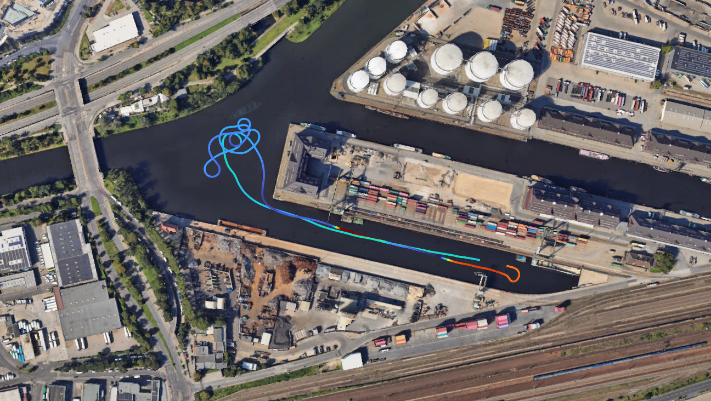
  &nbsp;
  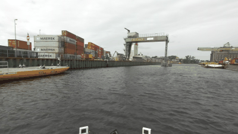
</p>

---

#### `berlin_01`

**Note:** This scene covers a port area with aggressive maneuvers by the data collecting platform and a clear loop-closure opportunity. Ouster LiDAR data is unavailable.

<p align="center">
  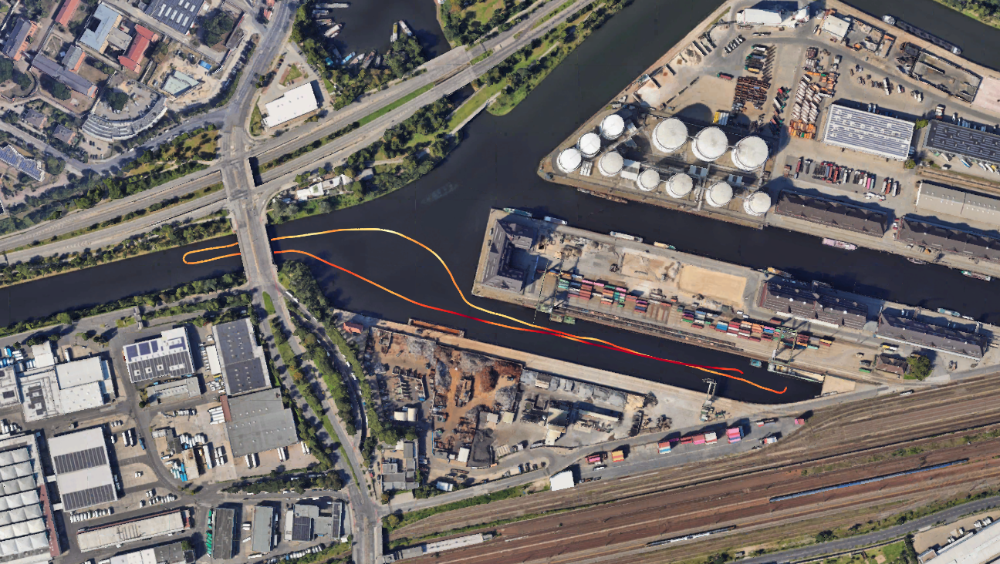
  &nbsp;
  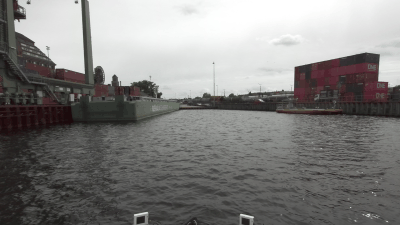
</p>

---

#### `berlin_02`

**Note:** This scene covers a port area with a loop-closure opportunity. Ouster LiDAR data is unavailable.

<p align="center">
  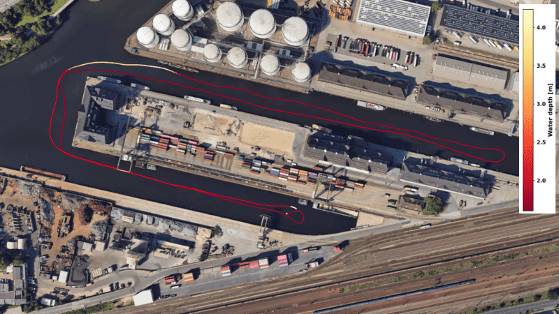
  &nbsp;
  
</p>

---

#### `berlin_03`

**Note:** This scene covers port and vegetation-dominated areas with a loop-closure opportunity, bridge passings, and vessel encounters. Ouster LiDAR data is unavailable.

<p align="center">
  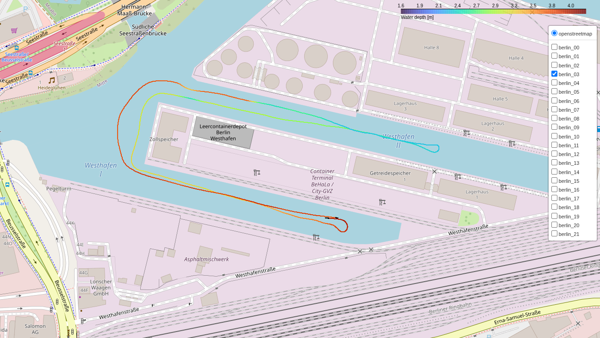
  &nbsp;
  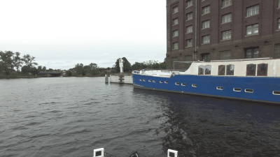
</p>

---

#### `berlin_04`

**Note:** This scene covers a forward and backward vegetation-dominated canal trajectory.

<p align="center">
  
  &nbsp;
  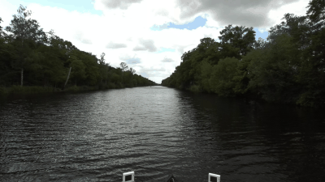
</p>

---

#### `berlin_05`

**Note:** This scene covers an urban area with bridge passings and vessel encounters. Sonar data is unavailable.

<p align="center">
  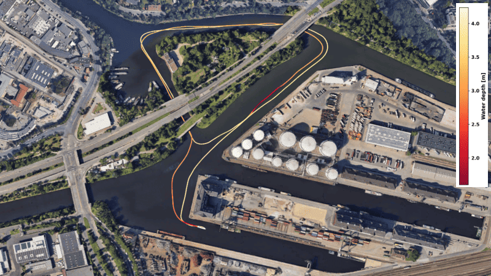
  &nbsp;
  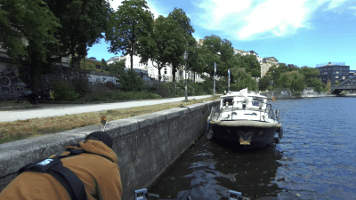
</p>

---

#### `berlin_06`

**Note:** This scene covers entry into and exit from a water lock.

<p align="center">
  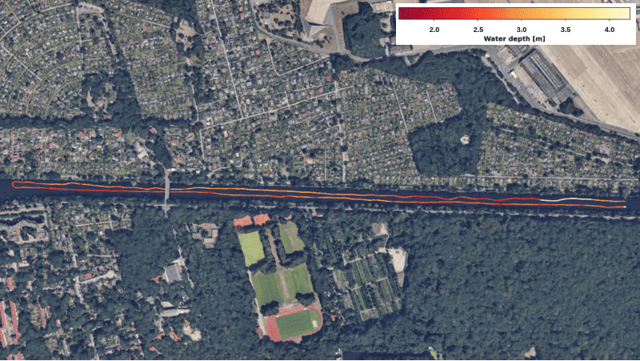
  &nbsp;
  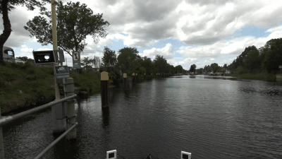
</p>

---

#### `berlin_07`

**Note:** This scene covers entry into and exit from a water lock, including a vessel encounter. Sonar data is unavailable.

<p align="center">
  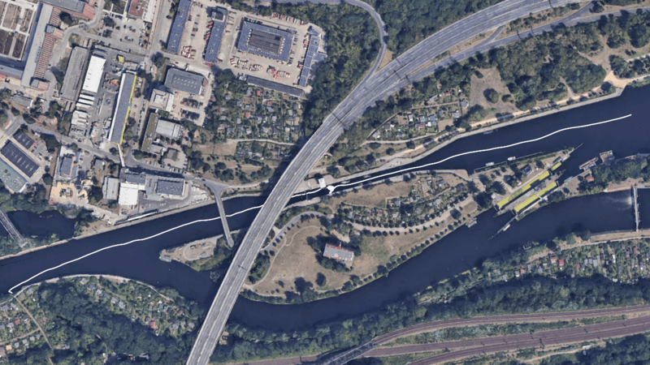
  &nbsp;
  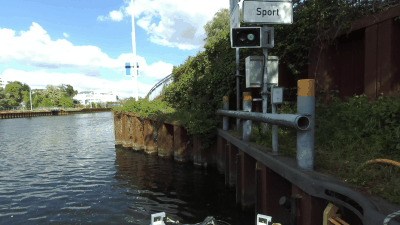
</p>

---

#### `berlin_08`

**Note:** This short scene covers urban and vegetation-dominated areas with vessel encounters, including bridge passings. Ouster LiDAR data is unavailable.

<p align="center">
  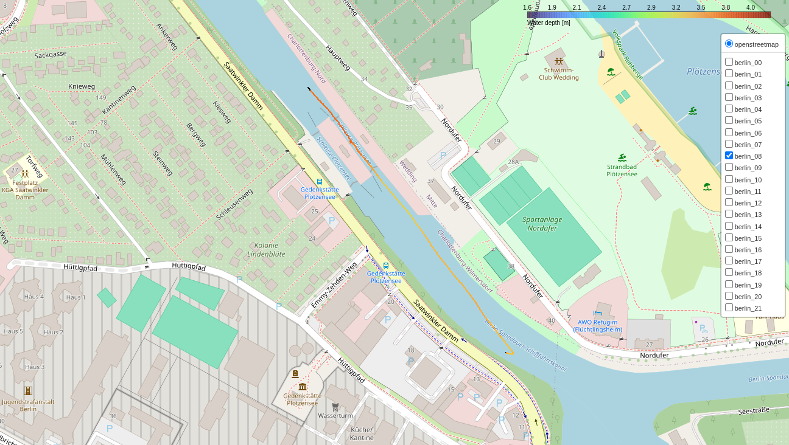
  &nbsp;
  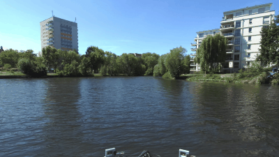
</p>

---

#### `berlin_09`

**Note:** This short scene covers urban and vegetation-dominated areas with vessel encounters, including bridge passings. Ouster LiDAR data is unavailable.

<p align="center">
  
  &nbsp;
  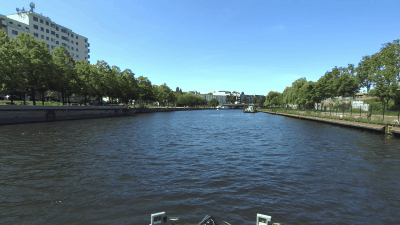
</p>

---

#### `berlin_10`

**Note:** This large scale scene covers urban and vegetation-dominated areas with multiple loop-closure opportunities, vessel encounters, and a port-area segment. Sonar data is unavailable.

<p align="center">
  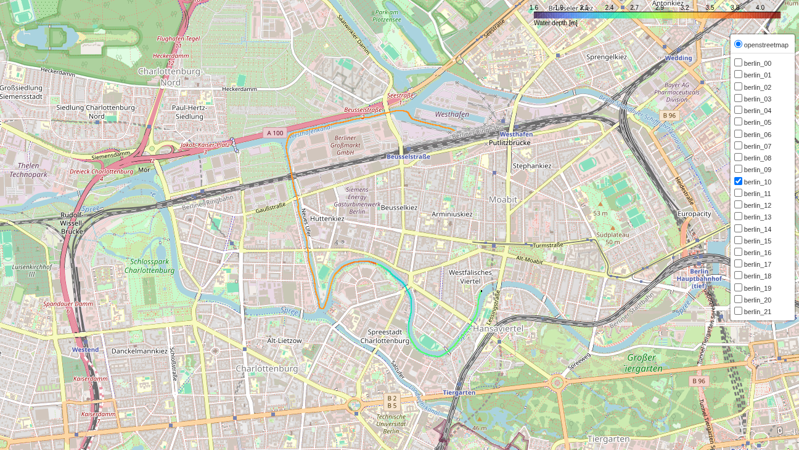
  &nbsp;
  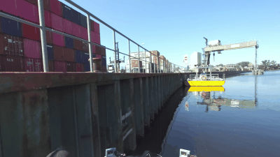
</p>

---

## Scene Details: Test Set

#### `berlin_11`

**Note:** This scene covers a port area with a loop-closure opportunity. Ouster LiDAR data is unavailable.

<p align="center">
  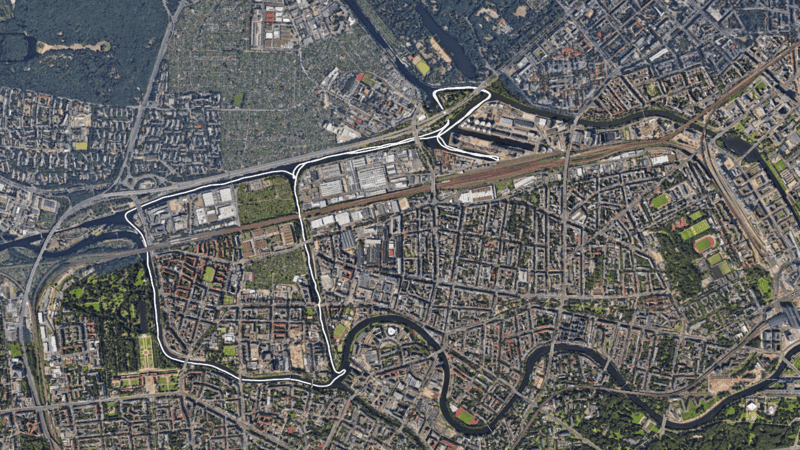
  &nbsp;
  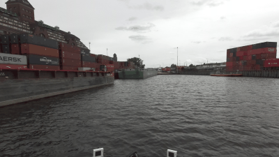
</p>

---

#### `berlin_12`

**Note:** This scene covers port and vegetation-dominated areas with a loop-closure opportunity, bridge passings, and vessel encounters. Ouster LiDAR data is unavailable.

<p align="center">
  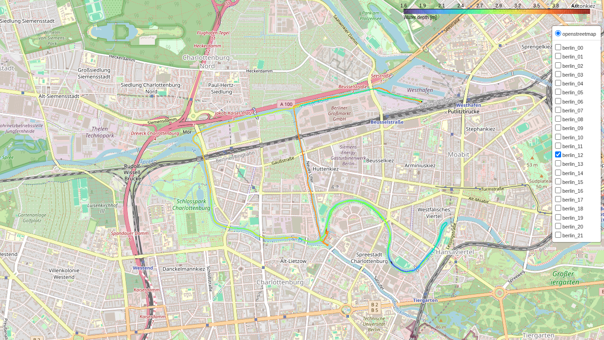
  &nbsp;
  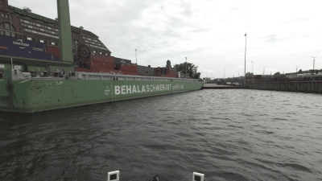
</p>

---

#### `berlin_13`

**Note:** This scene covers a narrow channel with multiple bridge passings and an encounter with vessels engaged in maintenance operations. Ouster LiDAR data is unavailable.

<p align="center">
  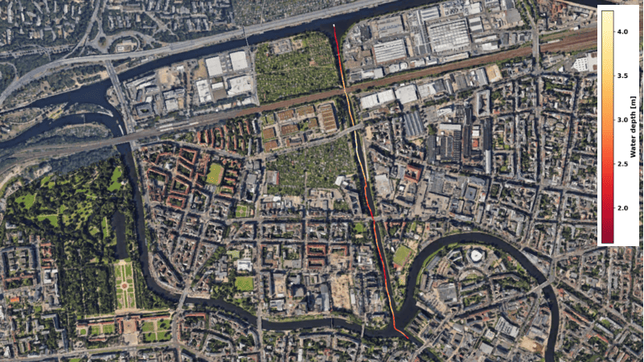
  &nbsp;
  
</p>

---

#### `berlin_14`

**Note:** This scene covers an urban area with multiple bridge passings and vessel encounters. Ouster LiDAR data is unavailable.

<p align="center">
  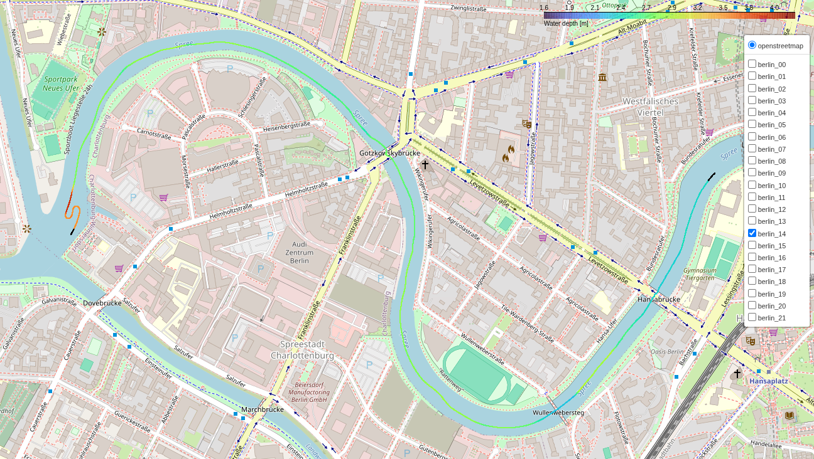
  &nbsp;
  
</p>

---

#### `berlin_15`

**Note:** This scene covers a vegetation-dominated area along a wide channel, with bridge passings and vessel encounters. Ouster and Livox LiDAR data are unavailable.

<p align="center">
  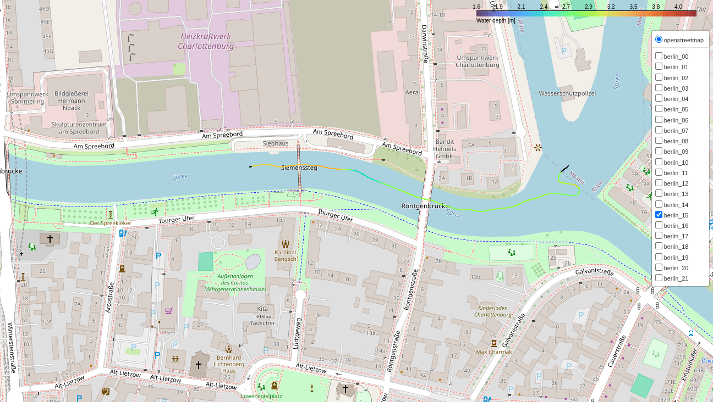
  &nbsp;
  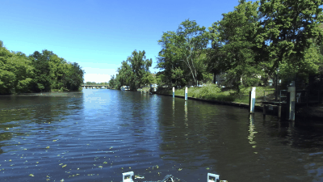
</p>

---

#### `berlin_16`

**Note:** This scene covers urban and vegetation-dominated areas with bridge passings and vessel encounters. Sonar data is unavailable.

<p align="center">
  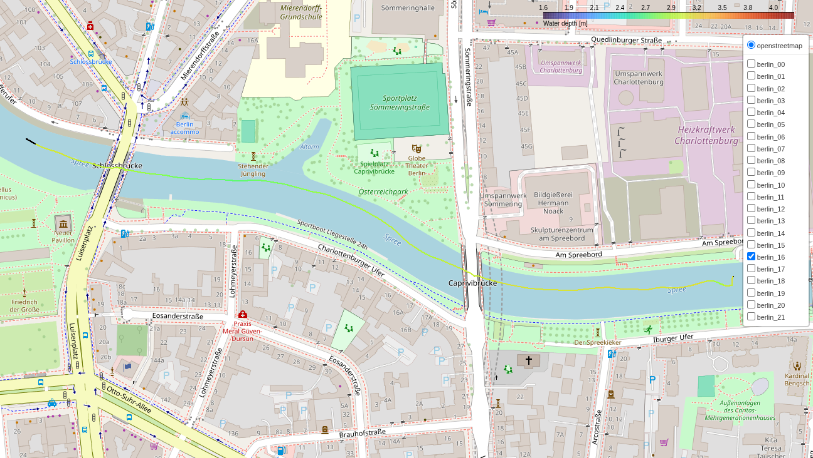
  &nbsp;
  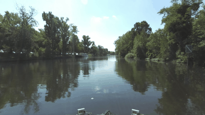
</p>

---

#### `berlin_17`

**Note:** This scene covers a port area with a loop-closure opportunity, bridge passings, and vessel encounters. Sonar data is unavailable.

<p align="center">
  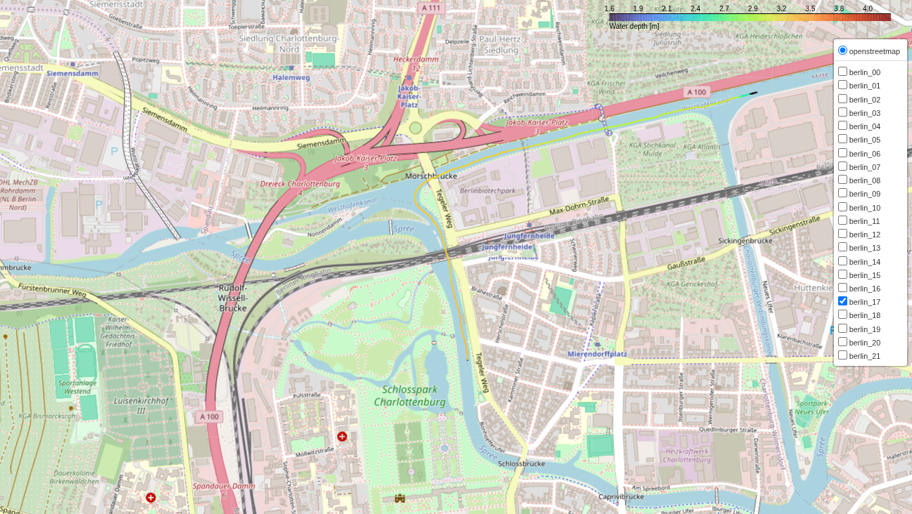
  &nbsp;
  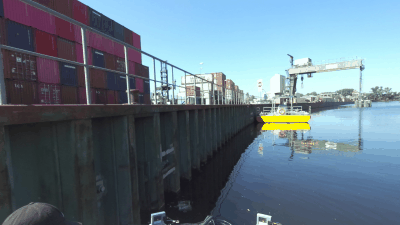
</p>

---

#### `berlin_18`

**Note:** This scene covers a narrow channel with bridge passings and an encounter with vessels engaged in maintenance operations. Sonar data is unavailable.

<p align="center">
  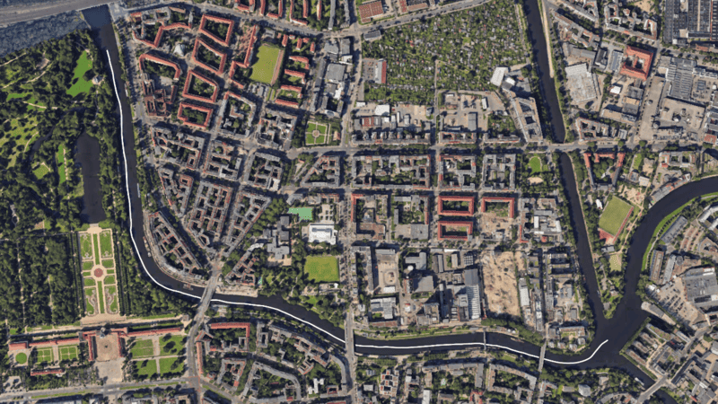
  &nbsp;
  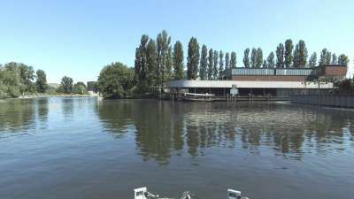
</p>

---

#### `berlin_19`

**Note:** This scene covers urban and vegetation-dominated areas along a wide channel, with bridge passings and vessel encounters. Sonar data is unavailable.

<p align="center">
  
  &nbsp;
  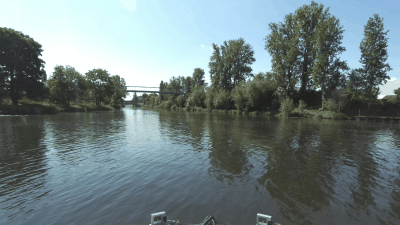
</p>

---

#### `berlin_20`

**Note:** This scene follows a long one-way trajectory through port, urban, and vegetation-dominated areas along a narrow channel, including an encounter with vessels engaged in maintenance operations. Ouster LiDAR data is unavailable.

<p align="center">
  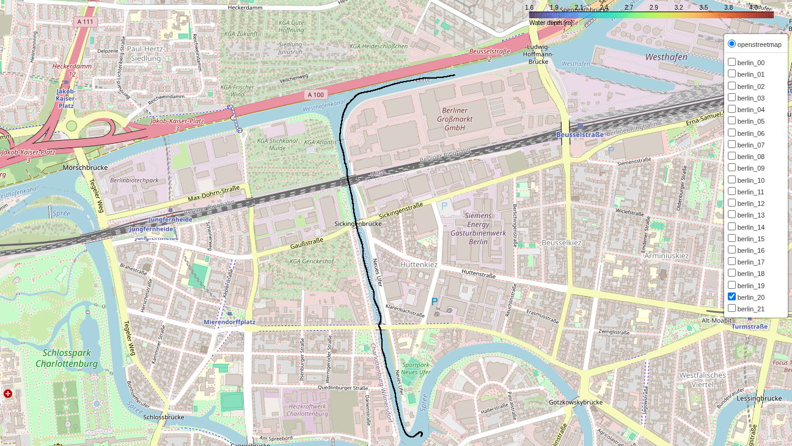
  &nbsp;
  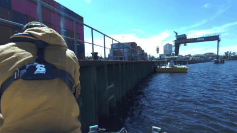
</p>

---

#### `berlin_21`

**Note:** This large scale scene covers urban and vegetation-dominated areas with multiple loop-closure opportunities, vessel encounters, and a port-area segment. Livox LiDAR data is unavailable near the end of the trajectory. Ouster LiDAR data is unavailable.

<p align="center">
  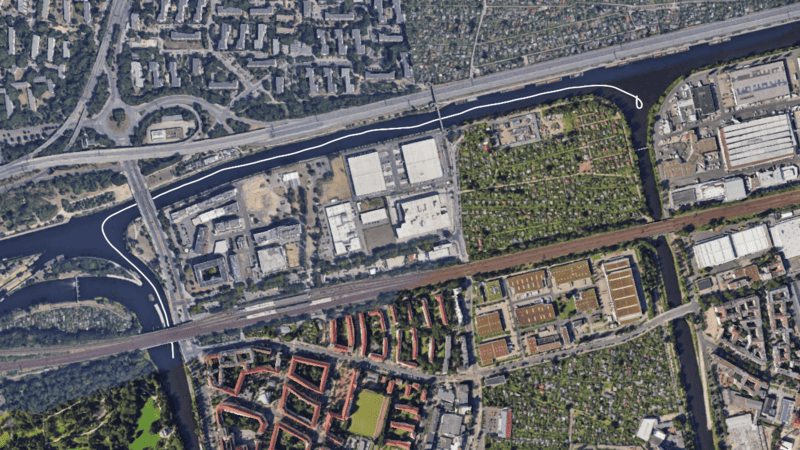
  &nbsp;
  
</p>

---

## Repeated-Environment Scene Groups

Several groups of scenes traverse the same or substantially overlapping environments at different times. These repeated-environment groups can be used to evaluate cross-session mapping consistency and compare algorithm performance under changing environmental and traffic conditions.

- `berlin_00` and `berlin_01`
- `berlin_02` and `berlin_11`
- `berlin_03`, `berlin_12`, and `berlin_17`
- `berlin_05` and `berlin_14`
- `berlin_10` and `berlin_21`
- `berlin_13` and `berlin_18`
- `berlin_15` and `berlin_19`


## SLAM Benchmark

We benchmark SLAM pipelines separately for each available LiDAR on training scenes 00–10 using Absolute Trajectory Error (ATE).

### Velodyne LiDAR

#### ATE position [m], 🟩 Best 🟦 Second best

<table border="4" frame="hsides" rules="rows" style="border-collapse: collapse;">
  <thead>
    <tr><th scope="col" align="center" style="border-top: 4px solid #6e7781; border-bottom: 4px solid #6e7781;">Group</th><th scope="col" align="center" style="border-top: 4px solid #6e7781; border-bottom: 4px solid #6e7781;">Algorithm</th><th scope="col" align="center" style="border-top: 4px solid #6e7781; border-bottom: 4px solid #6e7781;">00</th><th scope="col" align="center" style="border-top: 4px solid #6e7781; border-bottom: 4px solid #6e7781;">01</th><th scope="col" align="center" style="border-top: 4px solid #6e7781; border-bottom: 4px solid #6e7781;">02</th><th scope="col" align="center" style="border-top: 4px solid #6e7781; border-bottom: 4px solid #6e7781;">03</th><th scope="col" align="center" style="border-top: 4px solid #6e7781; border-bottom: 4px solid #6e7781;">04</th><th scope="col" align="center" style="border-top: 4px solid #6e7781; border-bottom: 4px solid #6e7781;">05</th><th scope="col" align="center" style="border-top: 4px solid #6e7781; border-bottom: 4px solid #6e7781;">06</th><th scope="col" align="center" style="border-top: 4px solid #6e7781; border-bottom: 4px solid #6e7781;">07</th><th scope="col" align="center" style="border-top: 4px solid #6e7781; border-bottom: 4px solid #6e7781;">08</th><th scope="col" align="center" style="border-top: 4px solid #6e7781; border-bottom: 4px solid #6e7781;">09</th><th scope="col" align="center" style="border-top: 4px solid #6e7781; border-bottom: 4px solid #6e7781;">10</th></tr>
  </thead>
  <tbody>
    <tr><th rowspan="7" scope="rowgroup" align="center" valign="middle" style="border-bottom: 4px solid #6e7781;"></th><th scope="row" align="left" style="border-bottom: 1px solid #6e7781;"><a href="https://github.com/hku-mars/FAST_LIO">FASTLIO2</a></th><td align="right" style="border-bottom: 1px solid #6e7781;">9.72</td><td align="right" style="border-bottom: 1px solid #6e7781;">2.37</td><td align="right" style="border-bottom: 1px solid #6e7781;">12.45</td><td align="right" style="border-bottom: 1px solid #6e7781;">25.46</td><td align="right" style="border-bottom: 1px solid #6e7781;">48.04</td><td align="right" style="border-bottom: 1px solid #6e7781;">47.30</td><td align="right" style="border-bottom: 1px solid #6e7781;">1.82</td><td align="right" style="border-bottom: 1px solid #6e7781;">22.51</td><td align="right" style="border-bottom: 1px solid #6e7781;">2.10</td><td align="right" style="border-bottom: 1px solid #6e7781;">5.56</td><td align="right" style="border-bottom: 1px solid #6e7781; background-color: #1b5e20; color: #fff; font-weight: bold;">86.09</td></tr>
    <tr><th scope="row" align="left" style="border-bottom: 1px solid #6e7781;"><a href="https://github.com/TixiaoShan/LIO-SAM">LIOSAM</a></th><td align="right" style="border-bottom: 1px solid #6e7781;">1.16</td><td align="right" style="border-bottom: 1px solid #6e7781; background-color: #1b5e20; color: #fff; font-weight: bold;">0.45</td><td align="right" style="border-bottom: 1px solid #6e7781;">3.26</td><td align="right" style="border-bottom: 1px solid #6e7781; background-color: #1b5e20; color: #fff; font-weight: bold;">1.91</td><td align="right" style="border-bottom: 1px solid #6e7781; background-color: #1b5e20; color: #fff; font-weight: bold;">4.70</td><td align="right" style="border-bottom: 1px solid #6e7781; background-color: #0d47a1; color: #fff;">5.44</td><td align="right" style="border-bottom: 1px solid #6e7781;">2.12</td><td align="right" style="border-bottom: 1px solid #6e7781;">4.90</td><td align="right" style="border-bottom: 1px solid #6e7781; background-color: #0d47a1; color: #fff;">0.43</td><td align="right" style="border-bottom: 1px solid #6e7781;">3.95</td><td align="right" style="border-bottom: 1px solid #6e7781;">132.77</td></tr>
    <tr><th scope="row" align="left" style="border-bottom: 1px solid #6e7781;"><a href="https://github.com/YJZLuckyBoy/liorf">LIORF</a></th><td align="right" style="border-bottom: 1px solid #6e7781; background-color: #0d47a1; color: #fff;">1.07</td><td align="right" style="border-bottom: 1px solid #6e7781; background-color: #0d47a1; color: #fff;">0.53</td><td align="right" style="border-bottom: 1px solid #6e7781; background-color: #0d47a1; color: #fff;">3.11</td><td align="right" style="border-bottom: 1px solid #6e7781; background-color: #0d47a1; color: #fff;">2.38</td><td align="right" style="border-bottom: 1px solid #6e7781;">21.40</td><td align="right" style="border-bottom: 1px solid #6e7781;">5.54</td><td align="right" style="border-bottom: 1px solid #6e7781; background-color: #0d47a1; color: #fff;">0.56</td><td align="right" style="border-bottom: 1px solid #6e7781;">854.26</td><td align="right" style="border-bottom: 1px solid #6e7781; background-color: #1b5e20; color: #fff; font-weight: bold;">0.42</td><td align="right" style="border-bottom: 1px solid #6e7781; background-color: #1b5e20; color: #fff; font-weight: bold;">1.09</td><td align="right" style="border-bottom: 1px solid #6e7781;">—</td></tr>
    <tr><th scope="row" align="left" style="border-bottom: 1px solid #6e7781;"><a href="https://github.com/url-kaist/se3-lio">SE3LIO</a></th><td align="right" style="border-bottom: 1px solid #6e7781;">2.12</td><td align="right" style="border-bottom: 1px solid #6e7781;">0.84</td><td align="right" style="border-bottom: 1px solid #6e7781; background-color: #1b5e20; color: #fff; font-weight: bold;">2.40</td><td align="right" style="border-bottom: 1px solid #6e7781;">3.47</td><td align="right" style="border-bottom: 1px solid #6e7781; background-color: #0d47a1; color: #fff;">11.68</td><td align="right" style="border-bottom: 1px solid #6e7781;">6.88</td><td align="right" style="border-bottom: 1px solid #6e7781;">1.81</td><td align="right" style="border-bottom: 1px solid #6e7781; background-color: #1b5e20; color: #fff; font-weight: bold;">1.16</td><td align="right" style="border-bottom: 1px solid #6e7781;">0.56</td><td align="right" style="border-bottom: 1px solid #6e7781;">1.76</td><td align="right" style="border-bottom: 1px solid #6e7781; background-color: #0d47a1; color: #fff;">98.76</td></tr>
    <tr><th scope="row" align="left" style="border-bottom: 1px solid #6e7781;"><a href="https://github.com/ethz-asl/BIEVR-LIO">BIEVRLIO</a></th><td align="right" style="border-bottom: 1px solid #6e7781; background-color: #1b5e20; color: #fff; font-weight: bold;">0.88</td><td align="right" style="border-bottom: 1px solid #6e7781;">0.83</td><td align="right" style="border-bottom: 1px solid #6e7781;">12.59</td><td align="right" style="border-bottom: 1px solid #6e7781;">4.07</td><td align="right" style="border-bottom: 1px solid #6e7781;">11.87</td><td align="right" style="border-bottom: 1px solid #6e7781; background-color: #1b5e20; color: #fff; font-weight: bold;">4.24</td><td align="right" style="border-bottom: 1px solid #6e7781; background-color: #1b5e20; color: #fff; font-weight: bold;">0.41</td><td align="right" style="border-bottom: 1px solid #6e7781; background-color: #0d47a1; color: #fff;">2.31</td><td align="right" style="border-bottom: 1px solid #6e7781;">1.05</td><td align="right" style="border-bottom: 1px solid #6e7781; background-color: #0d47a1; color: #fff;">1.16</td><td align="right" style="border-bottom: 1px solid #6e7781;">113.16</td></tr>
    <tr><th scope="row" align="left" style="border-bottom: 1px solid #6e7781;"><a href="https://github.com/cocel-postech/genz-lio">GENZLIO</a></th><td align="right" style="border-bottom: 1px solid #6e7781;">8.62</td><td align="right" style="border-bottom: 1px solid #6e7781;">1.06</td><td align="right" style="border-bottom: 1px solid #6e7781;">19.86</td><td align="right" style="border-bottom: 1px solid #6e7781;">20.71</td><td align="right" style="border-bottom: 1px solid #6e7781;">29.24</td><td align="right" style="border-bottom: 1px solid #6e7781;">30.10</td><td align="right" style="border-bottom: 1px solid #6e7781;">1.24</td><td align="right" style="border-bottom: 1px solid #6e7781;">3.49</td><td align="right" style="border-bottom: 1px solid #6e7781;">2.07</td><td align="right" style="border-bottom: 1px solid #6e7781;">2.99</td><td align="right" style="border-bottom: 1px solid #6e7781;">—</td></tr>
    <tr><th scope="row" align="left" style="border-bottom: 4px solid #6e7781;"><a href="https://github.com/PRBonn/rko_lio">RKOLIO</a></th><td align="right" style="border-bottom: 4px solid #6e7781;">15.95</td><td align="right" style="border-bottom: 4px solid #6e7781;">5.60</td><td align="right" style="border-bottom: 4px solid #6e7781;">53.36</td><td align="right" style="border-bottom: 4px solid #6e7781;">27.90</td><td align="right" style="border-bottom: 4px solid #6e7781;">77.19</td><td align="right" style="border-bottom: 4px solid #6e7781;">32.89</td><td align="right" style="border-bottom: 4px solid #6e7781;">3.52</td><td align="right" style="border-bottom: 4px solid #6e7781;">54.74</td><td align="right" style="border-bottom: 4px solid #6e7781;">2.73</td><td align="right" style="border-bottom: 4px solid #6e7781;">10.98</td><td align="right" style="border-bottom: 4px solid #6e7781;">—</td></tr>
    <tr><th rowspan="3" scope="rowgroup" align="center" valign="middle" style="border-bottom: 4px solid #6e7781;"></th><th scope="row" align="left" style="border-bottom: 1px solid #6e7781;"><a href="https://github.com/PRBonn/kiss-slam">KISS-SLAM</a></th><td align="right" style="border-bottom: 1px solid #6e7781;">22.88</td><td align="right" style="border-bottom: 1px solid #6e7781;">5.62</td><td align="right" style="border-bottom: 1px solid #6e7781;">45.10</td><td align="right" style="border-bottom: 1px solid #6e7781;">13.74</td><td align="right" style="border-bottom: 1px solid #6e7781;">118.57</td><td align="right" style="border-bottom: 1px solid #6e7781;">53.97</td><td align="right" style="border-bottom: 1px solid #6e7781;">5.50</td><td align="right" style="border-bottom: 1px solid #6e7781;">25.11</td><td align="right" style="border-bottom: 1px solid #6e7781;">4.37</td><td align="right" style="border-bottom: 1px solid #6e7781;">15.86</td><td align="right" style="border-bottom: 1px solid #6e7781;">759.63</td></tr>
    <tr><th scope="row" align="left" style="border-bottom: 1px solid #6e7781;"><a href="https://github.com/PRBonn/kiss-icp">KISS-ICP</a></th><td align="right" style="border-bottom: 1px solid #6e7781;">—</td><td align="right" style="border-bottom: 1px solid #6e7781;">—</td><td align="right" style="border-bottom: 1px solid #6e7781;">—</td><td align="right" style="border-bottom: 1px solid #6e7781;">—</td><td align="right" style="border-bottom: 1px solid #6e7781;">—</td><td align="right" style="border-bottom: 1px solid #6e7781;">—</td><td align="right" style="border-bottom: 1px solid #6e7781;">—</td><td align="right" style="border-bottom: 1px solid #6e7781;">—</td><td align="right" style="border-bottom: 1px solid #6e7781;">—</td><td align="right" style="border-bottom: 1px solid #6e7781;">—</td><td align="right" style="border-bottom: 1px solid #6e7781;">—</td></tr>
    <tr><th scope="row" align="left" style="border-bottom: 4px solid #6e7781;"><a href="https://github.com/cocel-postech/genz-icp">GENZ-ICP</a></th><td align="right" style="border-bottom: 4px solid #6e7781;">—</td><td align="right" style="border-bottom: 4px solid #6e7781;">—</td><td align="right" style="border-bottom: 4px solid #6e7781;">—</td><td align="right" style="border-bottom: 4px solid #6e7781;">—</td><td align="right" style="border-bottom: 4px solid #6e7781;">—</td><td align="right" style="border-bottom: 4px solid #6e7781;">—</td><td align="right" style="border-bottom: 4px solid #6e7781;">—</td><td align="right" style="border-bottom: 4px solid #6e7781;">—</td><td align="right" style="border-bottom: 4px solid #6e7781;">—</td><td align="right" style="border-bottom: 4px solid #6e7781;">—</td><td align="right" style="border-bottom: 4px solid #6e7781;">—</td></tr>
  </tbody>
</table>

### Livox LiDAR

#### ATE position [m]

<table border="4" frame="hsides" rules="rows" style="border-collapse: collapse;">
  <thead>
    <tr><th scope="col" align="center" style="border-top: 4px solid #6e7781; border-bottom: 4px solid #6e7781;">Group</th><th scope="col" align="center" style="border-top: 4px solid #6e7781; border-bottom: 4px solid #6e7781;">Algorithm</th><th scope="col" align="center" style="border-top: 4px solid #6e7781; border-bottom: 4px solid #6e7781;">00</th><th scope="col" align="center" style="border-top: 4px solid #6e7781; border-bottom: 4px solid #6e7781;">01</th><th scope="col" align="center" style="border-top: 4px solid #6e7781; border-bottom: 4px solid #6e7781;">02</th><th scope="col" align="center" style="border-top: 4px solid #6e7781; border-bottom: 4px solid #6e7781;">03</th><th scope="col" align="center" style="border-top: 4px solid #6e7781; border-bottom: 4px solid #6e7781;">04</th><th scope="col" align="center" style="border-top: 4px solid #6e7781; border-bottom: 4px solid #6e7781;">05</th><th scope="col" align="center" style="border-top: 4px solid #6e7781; border-bottom: 4px solid #6e7781;">06</th><th scope="col" align="center" style="border-top: 4px solid #6e7781; border-bottom: 4px solid #6e7781;">07</th><th scope="col" align="center" style="border-top: 4px solid #6e7781; border-bottom: 4px solid #6e7781;">08</th><th scope="col" align="center" style="border-top: 4px solid #6e7781; border-bottom: 4px solid #6e7781;">09</th><th scope="col" align="center" style="border-top: 4px solid #6e7781; border-bottom: 4px solid #6e7781;">10</th></tr>
  </thead>
  <tbody>
    <tr><th rowspan="7" scope="rowgroup" align="center" valign="middle" style="border-bottom: 4px solid #6e7781;"></th><th scope="row" align="left" style="border-bottom: 1px solid #6e7781;"><a href="https://github.com/hku-mars/FAST_LIO">FASTLIO2</a></th><td align="right" style="border-bottom: 1px solid #6e7781;">—</td><td align="right" style="border-bottom: 1px solid #6e7781;">—</td><td align="right" style="border-bottom: 1px solid #6e7781;">—</td><td align="right" style="border-bottom: 1px solid #6e7781;">—</td><td align="right" style="border-bottom: 1px solid #6e7781;">—</td><td align="right" style="border-bottom: 1px solid #6e7781;">—</td><td align="right" style="border-bottom: 1px solid #6e7781;">—</td><td align="right" style="border-bottom: 1px solid #6e7781;">—</td><td align="right" style="border-bottom: 1px solid #6e7781;">—</td><td align="right" style="border-bottom: 1px solid #6e7781;">—</td><td align="right" style="border-bottom: 1px solid #6e7781;">—</td></tr>
    <tr><th scope="row" align="left" style="border-bottom: 1px solid #6e7781;"><a href="https://github.com/TixiaoShan/LIO-SAM">LIOSAM</a></th><td align="right" style="border-bottom: 1px solid #6e7781;">—</td><td align="right" style="border-bottom: 1px solid #6e7781;">—</td><td align="right" style="border-bottom: 1px solid #6e7781;">—</td><td align="right" style="border-bottom: 1px solid #6e7781;">—</td><td align="right" style="border-bottom: 1px solid #6e7781;">—</td><td align="right" style="border-bottom: 1px solid #6e7781;">—</td><td align="right" style="border-bottom: 1px solid #6e7781;">—</td><td align="right" style="border-bottom: 1px solid #6e7781;">—</td><td align="right" style="border-bottom: 1px solid #6e7781;">—</td><td align="right" style="border-bottom: 1px solid #6e7781;">—</td><td align="right" style="border-bottom: 1px solid #6e7781;">—</td></tr>
    <tr><th scope="row" align="left" style="border-bottom: 1px solid #6e7781;"><a href="https://github.com/YJZLuckyBoy/liorf">LIORF</a></th><td align="right" style="border-bottom: 1px solid #6e7781;">—</td><td align="right" style="border-bottom: 1px solid #6e7781;">—</td><td align="right" style="border-bottom: 1px solid #6e7781;">—</td><td align="right" style="border-bottom: 1px solid #6e7781;">—</td><td align="right" style="border-bottom: 1px solid #6e7781;">—</td><td align="right" style="border-bottom: 1px solid #6e7781;">—</td><td align="right" style="border-bottom: 1px solid #6e7781;">—</td><td align="right" style="border-bottom: 1px solid #6e7781;">—</td><td align="right" style="border-bottom: 1px solid #6e7781;">—</td><td align="right" style="border-bottom: 1px solid #6e7781;">—</td><td align="right" style="border-bottom: 1px solid #6e7781;">—</td></tr>
    <tr><th scope="row" align="left" style="border-bottom: 1px solid #6e7781;"><a href="https://github.com/url-kaist/se3-lio">SE3LIO</a></th><td align="right" style="border-bottom: 1px solid #6e7781;">—</td><td align="right" style="border-bottom: 1px solid #6e7781;">—</td><td align="right" style="border-bottom: 1px solid #6e7781;">—</td><td align="right" style="border-bottom: 1px solid #6e7781;">—</td><td align="right" style="border-bottom: 1px solid #6e7781;">—</td><td align="right" style="border-bottom: 1px solid #6e7781;">—</td><td align="right" style="border-bottom: 1px solid #6e7781;">—</td><td align="right" style="border-bottom: 1px solid #6e7781;">—</td><td align="right" style="border-bottom: 1px solid #6e7781;">—</td><td align="right" style="border-bottom: 1px solid #6e7781;">—</td><td align="right" style="border-bottom: 1px solid #6e7781;">—</td></tr>
    <tr><th scope="row" align="left" style="border-bottom: 1px solid #6e7781;"><a href="https://github.com/ethz-asl/BIEVR-LIO">BIEVRLIO</a></th><td align="right" style="border-bottom: 1px solid #6e7781;">—</td><td align="right" style="border-bottom: 1px solid #6e7781;">—</td><td align="right" style="border-bottom: 1px solid #6e7781;">—</td><td align="right" style="border-bottom: 1px solid #6e7781;">—</td><td align="right" style="border-bottom: 1px solid #6e7781;">—</td><td align="right" style="border-bottom: 1px solid #6e7781;">—</td><td align="right" style="border-bottom: 1px solid #6e7781;">—</td><td align="right" style="border-bottom: 1px solid #6e7781;">—</td><td align="right" style="border-bottom: 1px solid #6e7781;">—</td><td align="right" style="border-bottom: 1px solid #6e7781;">—</td><td align="right" style="border-bottom: 1px solid #6e7781;">—</td></tr>
    <tr><th scope="row" align="left" style="border-bottom: 1px solid #6e7781;"><a href="https://github.com/cocel-postech/genz-lio">GENZLIO</a></th><td align="right" style="border-bottom: 1px solid #6e7781;">—</td><td align="right" style="border-bottom: 1px solid #6e7781;">—</td><td align="right" style="border-bottom: 1px solid #6e7781;">—</td><td align="right" style="border-bottom: 1px solid #6e7781;">—</td><td align="right" style="border-bottom: 1px solid #6e7781;">—</td><td align="right" style="border-bottom: 1px solid #6e7781;">—</td><td align="right" style="border-bottom: 1px solid #6e7781;">—</td><td align="right" style="border-bottom: 1px solid #6e7781;">—</td><td align="right" style="border-bottom: 1px solid #6e7781;">—</td><td align="right" style="border-bottom: 1px solid #6e7781;">—</td><td align="right" style="border-bottom: 1px solid #6e7781;">—</td></tr>
    <tr><th scope="row" align="left" style="border-bottom: 4px solid #6e7781;"><a href="https://github.com/PRBonn/rko_lio">RKOLIO</a></th><td align="right" style="border-bottom: 4px solid #6e7781;">—</td><td align="right" style="border-bottom: 4px solid #6e7781;">—</td><td align="right" style="border-bottom: 4px solid #6e7781;">—</td><td align="right" style="border-bottom: 4px solid #6e7781;">—</td><td align="right" style="border-bottom: 4px solid #6e7781;">—</td><td align="right" style="border-bottom: 4px solid #6e7781;">—</td><td align="right" style="border-bottom: 4px solid #6e7781;">—</td><td align="right" style="border-bottom: 4px solid #6e7781;">—</td><td align="right" style="border-bottom: 4px solid #6e7781;">—</td><td align="right" style="border-bottom: 4px solid #6e7781;">—</td><td align="right" style="border-bottom: 4px solid #6e7781;">—</td></tr>
    <tr><th rowspan="3" scope="rowgroup" align="center" valign="middle" style="border-bottom: 4px solid #6e7781;"></th><th scope="row" align="left" style="border-bottom: 1px solid #6e7781;"><a href="https://github.com/PRBonn/kiss-slam">KISS-SLAM</a></th><td align="right" style="border-bottom: 1px solid #6e7781;">19.93</td><td align="right" style="border-bottom: 1px solid #6e7781;">0.89</td><td align="right" style="border-bottom: 1px solid #6e7781;">1.12</td><td align="right" style="border-bottom: 1px solid #6e7781;">5.43</td><td align="right" style="border-bottom: 1px solid #6e7781;">10.12</td><td align="right" style="border-bottom: 1px solid #6e7781;">7.25</td><td align="right" style="border-bottom: 1px solid #6e7781;">0.15</td><td align="right" style="border-bottom: 1px solid #6e7781;">0.87</td><td align="right" style="border-bottom: 1px solid #6e7781;">0.52</td><td align="right" style="border-bottom: 1px solid #6e7781;">0.48</td><td align="right" style="border-bottom: 1px solid #6e7781;">142.43</td></tr>
    <tr><th scope="row" align="left" style="border-bottom: 1px solid #6e7781;"><a href="https://github.com/PRBonn/kiss-icp">KISS-ICP</a></th><td align="right" style="border-bottom: 1px solid #6e7781;">—</td><td align="right" style="border-bottom: 1px solid #6e7781;">—</td><td align="right" style="border-bottom: 1px solid #6e7781;">—</td><td align="right" style="border-bottom: 1px solid #6e7781;">—</td><td align="right" style="border-bottom: 1px solid #6e7781;">—</td><td align="right" style="border-bottom: 1px solid #6e7781;">—</td><td align="right" style="border-bottom: 1px solid #6e7781;">—</td><td align="right" style="border-bottom: 1px solid #6e7781;">—</td><td align="right" style="border-bottom: 1px solid #6e7781;">—</td><td align="right" style="border-bottom: 1px solid #6e7781;">—</td><td align="right" style="border-bottom: 1px solid #6e7781;">—</td></tr>
    <tr><th scope="row" align="left" style="border-bottom: 4px solid #6e7781;"><a href="https://github.com/cocel-postech/genz-icp">GENZ-ICP</a></th><td align="right" style="border-bottom: 4px solid #6e7781;">—</td><td align="right" style="border-bottom: 4px solid #6e7781;">—</td><td align="right" style="border-bottom: 4px solid #6e7781;">—</td><td align="right" style="border-bottom: 4px solid #6e7781;">—</td><td align="right" style="border-bottom: 4px solid #6e7781;">—</td><td align="right" style="border-bottom: 4px solid #6e7781;">—</td><td align="right" style="border-bottom: 4px solid #6e7781;">—</td><td align="right" style="border-bottom: 4px solid #6e7781;">—</td><td align="right" style="border-bottom: 4px solid #6e7781;">—</td><td align="right" style="border-bottom: 4px solid #6e7781;">—</td><td align="right" style="border-bottom: 4px solid #6e7781;">—</td></tr>
  </tbody>
</table>

### Ouster LiDAR

**Note:** Ouster LiDAR data is unavailable for scenes 00–03 and 08–09, so these scenes are omitted from the table.

#### ATE position [m]

<table border="4" frame="hsides" rules="rows" style="border-collapse: collapse;">
  <thead>
    <tr><th scope="col" align="center" style="border-top: 4px solid #6e7781; border-bottom: 4px solid #6e7781;">Group</th><th scope="col" align="center" style="border-top: 4px solid #6e7781; border-bottom: 4px solid #6e7781;">Algorithm</th><th scope="col" align="center" style="border-top: 4px solid #6e7781; border-bottom: 4px solid #6e7781;">04</th><th scope="col" align="center" style="border-top: 4px solid #6e7781; border-bottom: 4px solid #6e7781;">05</th><th scope="col" align="center" style="border-top: 4px solid #6e7781; border-bottom: 4px solid #6e7781;">06</th><th scope="col" align="center" style="border-top: 4px solid #6e7781; border-bottom: 4px solid #6e7781;">07</th><th scope="col" align="center" style="border-top: 4px solid #6e7781; border-bottom: 4px solid #6e7781;">10</th></tr>
  </thead>
  <tbody>
    <tr><th rowspan="7" scope="rowgroup" align="center" valign="middle" style="border-bottom: 4px solid #6e7781;"></th><th scope="row" align="left" style="border-bottom: 1px solid #6e7781;"><a href="https://github.com/hku-mars/FAST_LIO">FASTLIO2</a></th><td align="right" style="border-bottom: 1px solid #6e7781;">—</td><td align="right" style="border-bottom: 1px solid #6e7781;">—</td><td align="right" style="border-bottom: 1px solid #6e7781;">—</td><td align="right" style="border-bottom: 1px solid #6e7781;">—</td><td align="right" style="border-bottom: 1px solid #6e7781;">—</td></tr>
    <tr><th scope="row" align="left" style="border-bottom: 1px solid #6e7781;"><a href="https://github.com/TixiaoShan/LIO-SAM">LIOSAM</a></th><td align="right" style="border-bottom: 1px solid #6e7781;">—</td><td align="right" style="border-bottom: 1px solid #6e7781;">—</td><td align="right" style="border-bottom: 1px solid #6e7781;">—</td><td align="right" style="border-bottom: 1px solid #6e7781;">—</td><td align="right" style="border-bottom: 1px solid #6e7781;">—</td></tr>
    <tr><th scope="row" align="left" style="border-bottom: 1px solid #6e7781;"><a href="https://github.com/YJZLuckyBoy/liorf">LIORF</a></th><td align="right" style="border-bottom: 1px solid #6e7781;">—</td><td align="right" style="border-bottom: 1px solid #6e7781;">—</td><td align="right" style="border-bottom: 1px solid #6e7781;">—</td><td align="right" style="border-bottom: 1px solid #6e7781;">—</td><td align="right" style="border-bottom: 1px solid #6e7781;">—</td></tr>
    <tr><th scope="row" align="left" style="border-bottom: 1px solid #6e7781;"><a href="https://github.com/url-kaist/se3-lio">SE3LIO</a></th><td align="right" style="border-bottom: 1px solid #6e7781;">—</td><td align="right" style="border-bottom: 1px solid #6e7781;">—</td><td align="right" style="border-bottom: 1px solid #6e7781;">—</td><td align="right" style="border-bottom: 1px solid #6e7781;">—</td><td align="right" style="border-bottom: 1px solid #6e7781;">—</td></tr>
    <tr><th scope="row" align="left" style="border-bottom: 1px solid #6e7781;"><a href="https://github.com/ethz-asl/BIEVR-LIO">BIEVRLIO</a></th><td align="right" style="border-bottom: 1px solid #6e7781;">—</td><td align="right" style="border-bottom: 1px solid #6e7781;">—</td><td align="right" style="border-bottom: 1px solid #6e7781;">—</td><td align="right" style="border-bottom: 1px solid #6e7781;">—</td><td align="right" style="border-bottom: 1px solid #6e7781;">—</td></tr>
    <tr><th scope="row" align="left" style="border-bottom: 1px solid #6e7781;"><a href="https://github.com/cocel-postech/genz-lio">GENZLIO</a></th><td align="right" style="border-bottom: 1px solid #6e7781;">—</td><td align="right" style="border-bottom: 1px solid #6e7781;">—</td><td align="right" style="border-bottom: 1px solid #6e7781;">—</td><td align="right" style="border-bottom: 1px solid #6e7781;">—</td><td align="right" style="border-bottom: 1px solid #6e7781;">—</td></tr>
    <tr><th scope="row" align="left" style="border-bottom: 4px solid #6e7781;"><a href="https://github.com/PRBonn/rko_lio">RKOLIO</a></th><td align="right" style="border-bottom: 4px solid #6e7781;">—</td><td align="right" style="border-bottom: 4px solid #6e7781;">—</td><td align="right" style="border-bottom: 4px solid #6e7781;">—</td><td align="right" style="border-bottom: 4px solid #6e7781;">—</td><td align="right" style="border-bottom: 4px solid #6e7781;">—</td></tr>
    <tr><th rowspan="3" scope="rowgroup" align="center" valign="middle" style="border-bottom: 4px solid #6e7781;"></th><th scope="row" align="left" style="border-bottom: 1px solid #6e7781;"><a href="https://github.com/PRBonn/kiss-slam">KISS-SLAM</a></th><td align="right" style="border-bottom: 1px solid #6e7781;">86.36</td><td align="right" style="border-bottom: 1px solid #6e7781;">562.73</td><td align="right" style="border-bottom: 1px solid #6e7781;">1.07</td><td align="right" style="border-bottom: 1px solid #6e7781;">142.92</td><td align="right" style="border-bottom: 1px solid #6e7781;">206.66</td></tr>
    <tr><th scope="row" align="left" style="border-bottom: 1px solid #6e7781;"><a href="https://github.com/PRBonn/kiss-icp">KISS-ICP</a></th><td align="right" style="border-bottom: 1px solid #6e7781;">—</td><td align="right" style="border-bottom: 1px solid #6e7781;">—</td><td align="right" style="border-bottom: 1px solid #6e7781;">—</td><td align="right" style="border-bottom: 1px solid #6e7781;">—</td><td align="right" style="border-bottom: 1px solid #6e7781;">—</td></tr>
    <tr><th scope="row" align="left" style="border-bottom: 4px solid #6e7781;"><a href="https://github.com/cocel-postech/genz-icp">GENZ-ICP</a></th><td align="right" style="border-bottom: 4px solid #6e7781;">—</td><td align="right" style="border-bottom: 4px solid #6e7781;">—</td><td align="right" style="border-bottom: 4px solid #6e7781;">—</td><td align="right" style="border-bottom: 4px solid #6e7781;">—</td><td align="right" style="border-bottom: 4px solid #6e7781;">—</td></tr>
  </tbody>
</table>

---

### Example: LIO-SAM results on `berlin_00`, with and without GPS integration


## Segmentation Results

Qualitative semantic segmentation results: Each row shows the resized input image, ground truth, and predictions from U-Net Convolutional Network, Fully Convolutional Networks, and the Residual Network-based model across different scenes.

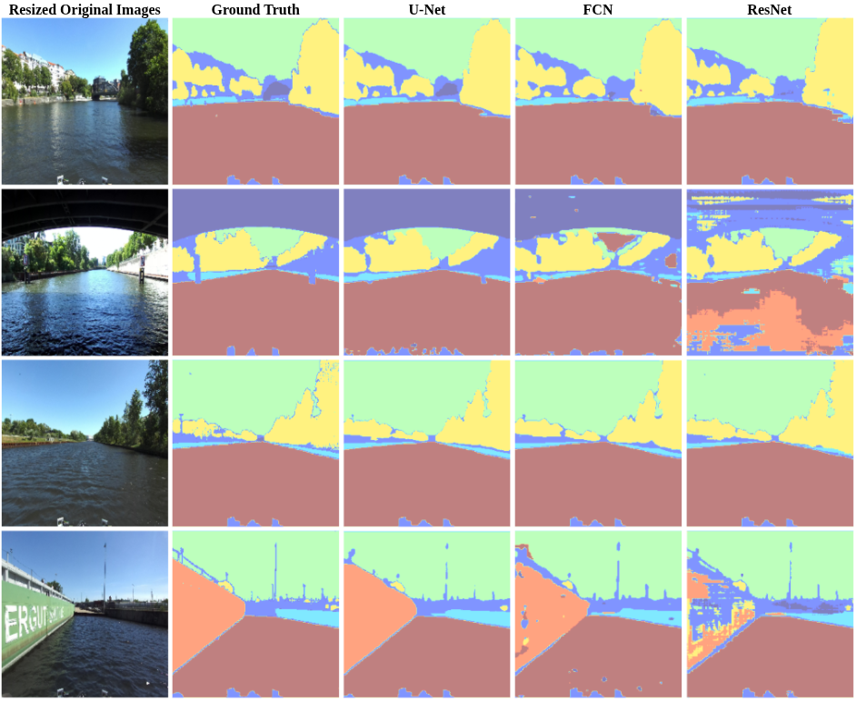

## GNSS RINEX Results

> <p style="color:red;">Add GNSS RINEX plots here</p>

## Acknowledgements

We thank all our colleagues who contributed during data collection campaign and for preparation of this dataset.

## License

This work is licensed under a Creative Commons Attribution-NonCommercial-ShareAlike 4.0 International License and is provided for non-commercial but academic use. If you are interested in using this dataset for commercial purposes, please contact us.
