# *Berlin Waters*: An Inland Waterway Dataset for Multi-Sensor SLAM and Semantic Segmentation

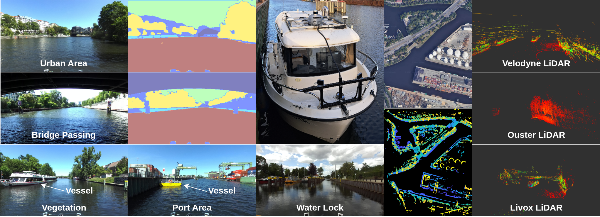

## Overview

*Berlin Waters* is a multimodal dataset collected on inland waterways in Berlin to support research in SLAM, perception, and semantic understanding.

## Dataset Highlights

- **22 scenes** (**11 train / 11 test**) spanning about **70 km** and **9 hours** on Berlin’s inland waterways
- **Diverse environments**: urban canals, ports, water locks, bridges, vegetation, and dynamic vessel traffic
- **Multi-sensor data** from Velodyne, Ouster, and Livox LiDARs, a stereo camera, IMU, and multi-antenna GNSS, stored as **ROS 2 bags** (SQLite3 `.db3` files)
- **Post-processed RTK-GNSS reference trajectories** together with raw GNSS observations in **RINEX format**
- **2,900** semantically annotated images across **seven classes**: sky, water, vegetation, bridge, vessel, river bank, and other

## Publication and Citation

Citation information will be provided soon.

## Contact

For questions, collaboration requests, or dataset access inquiries, please contact the authors at iulian.filip@dlr.de

## Sensor Setup

The data-collection platform "Aurora" measures 6.5 m long × 2.6 m wide × 2.8 m high and is equipped with the following sensors: 
- **LiDAR 1 (main LiDAR)** (Velodyne VLP32C, 10 Hz, HFOV 360°, VFOV 40°)
  - ROS 2 topic: `/VLP32/velodyne_points`
- **LiDAR 2** (Ouster OS0-128, 10 Hz, HFOV 360°, VFOV 90°)
  - ROS 2 topic: `/ouster/points`
- **LiDAR 3** (Livox Avia, 10 Hz, HFOV 70.4°, VFOV 77.2°)
  - ROS 2 topic: `/livox/lidar`
- **Stereo camera × 1** (StereoLabs ZED 2i, 1920×1080, 10 Hz, with IMU recorded at 400 Hz)
  - ROS 2 topics: `/zed/zed_node/left/image_rect_color/compressed`, `/zed/zed_node/right/image_rect_color/compressed`, `/zed/zed_node/imu/data`
- **IMU × 1** (xsens MTi-680G, 400 Hz, and 1 u-blox GNSS antenna connected to the xsens IMU (4 Hz))
  - ROS 2 topics: `/xsens/imu/data`, `/xsens/gnss`
- **u-blox GNSS antennas × 3** (connected to u-blox M8T EVK receivers (5 Hz))
  - ROS 2 topics: `/ublox_1/fix`, `/ublox_2/fix`, `/ublox_3/fix`
- **JAVAD GNSS receivers with roof-mounted geodetic antennas × 3** (raw GNSS observables, 2 Hz)
  - No ROS 2 topics; RINEX files (`.rnx` and `.obs`) are provided for each antenna
- **Sonar × 1** (stern-mounted, 0.1 Hz)
  - ROS 2 topic: `/water_depth`

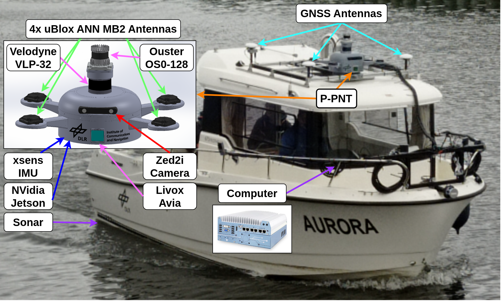


## Intrinsic and Extrinsic Parameters

The coordinates transformation between multiple sensors, and intrinsic parameters of camera are the same for all scenes and can be found via 
> <p style="color:red;">Link to Intrinsic and Extrinsic Parameters</p>

## Scene Overview

> <p style="color:red;">Access the dataset here. Link will be available soon.</p>

The following table summarizes date of collection, file size, the duration and traveled distance.
<!--
| Scene | Date of Collection | File Size | Duration [min] | Distance [km] | Velodyne LiDAR | Ouster LiDAR | Livox LiDAR | ZED 2i Camera | Xsens IMU | 3× u-blox | Xsens GNSS | 3× RINEX | Sonar | Description |
|:---|:---|:---|---:|---:|:---:|:---:|:---:|:---:|:---:|:---:|:---:|:---:|:---:|:---|
| `berlin_00` | May 22, 2025 | 21.5 GB | 10.3 | 1.42 | ✓ | ✗ | ✓ | ✓ | ✓ | ✓ | ✓ | ✓ | ✓ | Port area, bridge passage, loop closure |
| `berlin_01` | May 22, 2025 | 34.9 GB | 17.0 | 2.26 | ✓ | ✗ | ✓ | ✓ | ✓ | ✓ | ✓ | ✓ | ✓ | Port area, loop closure, vessel traffic |
| `berlin_02` | May 22, 2025 | 41.2 GB | 19.7 | 2.67 | ✓ | ✗ | ✓ | ✓ | ✓ | ✓ | ✓ | ✓ | ✓ | Port and vegetation-dominated areas, loop closure, bridges |
| `berlin_03` | May 22, 2025 | 87.6 GB | 21.9 | 3.53 | ✓ | ✓ | ✓ | ✓ | ✓ | ✓ | ✓ | ✓ | ✓ | Vegetation-dominated area, loop closure |
| `berlin_04` | May 21, 2025 | 74.2 GB | 18.6 | 2.65 | ✓ | ✓ | ✓ | ✓ | ✓ | ✓ | ✓ | ✓ | ✓ | Urban area, bridge passage |
| `berlin_05` | May 20, 2025 | 115.4 GB | 28.8 | 1.00 | ✓ | ✓ | ✓ | ✓ | ✓ | ✓ | ✓ | ✓ | ✗ | Water lock entry and exit |
| `berlin_06` | May 22, 2025 | 48.9 GB | 12.3 | 0.42 | ✓ | ✓ | ✓ | ✓ | ✓ | ✓ | ✓ | ✓ | ✓ | Water lock entry and exit |
| `berlin_07` | May 22, 2025 | 17.8 GB | 8.8 | 1.36 | ✓ | ✗ | ✓ | ✓ | ✓ | ✓ | ✓ | ✓ | ✓ | Port area, aggressive maneuvers, loop closure |
| `berlin_08` | May 22, 2025 | 27.7 GB | 13.7 | 1.96 | ✓ | ✗ | ✓ | ✓ | ✓ | ✓ | ✓ | ✓ | ✓ | Port area, loop closure, vessel traffic |
| `berlin_09` | May 22, 2025 | 29.1 GB | 13.9 | 1.85 | ✓ | ✗ | ✓ | ✓ | ✓ | ✓ | ✓ | ✓ | ✓ | Port and vegetation-dominated areas, loop closure, bridges |
| `berlin_10` | May 21, 2025 | 42.6 GB | 19.8 | 2.79 | ✓ | ✗ | ✓ | ✓ | ✓ | ✓ | ✓ | ✓ | ✓ | Urban area, bridge passage |
| `berlin_11` | May 20, 2025 | 68.7 GB | 16.4 | 2.14 | ✓ | ✓ | ✓ | ✓ | ✓ | ✓ | ✓ | ✓ | ✗ | Port area, loop closure, bridges, vessel traffic |
| `berlin_12` | May 20, 2025 | 84.5 GB | 19.5 | 2.28 | ✓ | ✓ | ✓ | ✓ | ✓ | ✓ | ✓ | ✓ | ✗ | Narrow channel, vessel traffic, bridges |
| `berlin_13` | May 21, 2025 | 31.7 GB | 14.7 | 1.81 | ✓ | ✗ | ✓ | ✓ | ✓ | ✓ | ✓ | ✓ | ✓ | Narrow channel, bridge passage |
| `berlin_14` | May 20, 2025 | 50.0 GB | 12.0 | 1.84 | ✓ | ✓ | ✓ | ✓ | ✓ | ✓ | ✓ | ✓ | ✗ | Urban and vegetation-dominated areas, vessel traffic, bridges |
| `berlin_15` | May 21, 2025 | 24.8 GB | 15.1 | 2.23 | ✓ | ✗ | ✗ | ✓ | ✓ | ✓ | ✓ | ✓ | ✓ | Vegetation-dominated area, vessel traffic, bridges |
| `berlin_16` | May 20, 2025 | 61.2 GB | 14.8 | 2.09 | ✓ | ✓ | ✓ | ✓ | ✓ | ✓ | ✓ | ✓ | ✗ | Urban and vegetation-dominated areas, vessel traffic, bridges |
| `berlin_17` | May 21, 2025 | 14.7 GB | 6.7 | 0.51 | ✓ | ✗ | ✓ | ✓ | ✓ | ✓ | ✓ | ✓ | ✓ | Urban and vegetation-dominated areas, vessel traffic |
| `berlin_18` | May 21, 2025 | 16.0 GB | 7.3 | 0.87 | ✓ | ✗ | ✓ | ✓ | ✓ | ✓ | ✓ | ✓ | ✓ | Urban and vegetation-dominated areas, vessel traffic |

**Legend:** ✓ available; ✗ unavailable.

-->

<!-- Scene summary table -->
<table>
  <thead>
    <tr><th>Set</th><th>Scene</th><th>Date of Collection</th><th>File Size</th><th>Duration [min]</th><th>Distance [km]</th></tr>
  </thead>
  <tbody>
    <tr><th rowspan="6" scope="rowgroup" style="border-bottom: 4px solid #6e7781;"></th><td><code>berlin_00</code></td><td>May 22, 2025</td><td>21.5 GB</td><td>10.3</td><td>1.42</td></tr>
    <tr><td><code>berlin_01</code></td><td>May 22, 2025</td><td>34.9 GB</td><td>17.0</td><td>2.26</td></tr>
    <tr><td><code>berlin_02</code></td><td>May 22, 2025</td><td>41.2 GB</td><td>19.7</td><td>2.67</td></tr>
    <tr><td><code>berlin_03</code></td><td>May 22, 2025</td><td>87.6 GB</td><td>21.9</td><td>3.53</td></tr>
    <tr><td><code>berlin_04</code></td><td>May 21, 2025</td><td>74.2 GB</td><td>18.6</td><td>2.65</td></tr>
    <tr><td style="border-bottom: 4px solid #6e7781;"><code>berlin_05</code></td><td style="border-bottom: 4px solid #6e7781;">May 20, 2025</td><td style="border-bottom: 4px solid #6e7781;">115.4 GB</td><td style="border-bottom: 4px solid #6e7781;">28.8</td><td style="border-bottom: 4px solid #6e7781;">1.00</td></tr>
    <tr><th rowspan="6" scope="rowgroup" style="border-bottom: 4px solid #6e7781;"></th><td><code>berlin_06</code></td><td>May 22, 2025</td><td>48.9 GB</td><td>12.3</td><td>0.42</td></tr>
    <tr><td><code>berlin_07</code></td><td>May 22, 2025</td><td>17.8 GB</td><td>8.8</td><td>1.36</td></tr>
    <tr><td><code>berlin_08</code></td><td>May 22, 2025</td><td>27.7 GB</td><td>13.7</td><td>1.96</td></tr>
    <tr><td><code>berlin_09</code></td><td>May 22, 2025</td><td>29.1 GB</td><td>13.9</td><td>1.85</td></tr>
    <tr><td><code>berlin_10</code></td><td>May 21, 2025</td><td>42.6 GB</td><td>19.8</td><td>2.79</td></tr>
    <tr><td style="border-bottom: 4px solid #6e7781;"><code>berlin_11</code></td><td style="border-bottom: 4px solid #6e7781;">May 20, 2025</td><td style="border-bottom: 4px solid #6e7781;">68.7 GB</td><td style="border-bottom: 4px solid #6e7781;">16.4</td><td style="border-bottom: 4px solid #6e7781;">2.14</td></tr>
    <tr><th rowspan="2" scope="rowgroup" style="border-bottom: 4px solid #6e7781;"></th><td><code>berlin_12</code></td><td>May 20, 2025</td><td>84.5 GB</td><td>19.5</td><td>2.28</td></tr>
    <tr><td style="border-bottom: 4px solid #6e7781;"><code>berlin_13</code></td><td style="border-bottom: 4px solid #6e7781;">May 21, 2025</td><td style="border-bottom: 4px solid #6e7781;">31.7 GB</td><td style="border-bottom: 4px solid #6e7781;">14.7</td><td style="border-bottom: 4px solid #6e7781;">1.81</td></tr>
    <tr><th rowspan="5" scope="rowgroup" style="border-bottom: 4px solid #6e7781;"></th><td><code>berlin_14</code></td><td>May 20, 2025</td><td>50.0 GB</td><td>12.0</td><td>1.84</td></tr>
    <tr><td><code>berlin_15</code></td><td>May 21, 2025</td><td>24.8 GB</td><td>15.1</td><td>2.23</td></tr>
    <tr><td><code>berlin_16</code></td><td>May 20, 2025</td><td>61.2 GB</td><td>14.8</td><td>2.09</td></tr>
    <tr><td><code>berlin_17</code></td><td>May 21, 2025</td><td>14.7 GB</td><td>6.7</td><td>0.51</td></tr>
    <tr><td style="border-bottom: 4px solid #6e7781;"><code>berlin_18</code></td><td style="border-bottom: 4px solid #6e7781;">May 21, 2025</td><td style="border-bottom: 4px solid #6e7781;">16.0 GB</td><td style="border-bottom: 4px solid #6e7781;">7.3</td><td style="border-bottom: 4px solid #6e7781;">0.87</td></tr>
  </tbody>
</table>

## Tools

Visualize *Berlin Waters* bags with `ros2 bag play` and our
[RViz visualizer](tools/visualization/ros2/README.md), which provides a sensor
layout and static transforms. A [Foxglove viewer](tools/visualization/foxglove/README.md)
is also available. Users without ROS 2 can inspect bags and extracted files
with [Rerun](tools/visualization/rerun/README.md). Use the
[data extractor](tools/extraction/README.md) to export camera images, LiDAR
point clouds, and IMU and GNSS data. The linked guides provide examples.

### Installation

Install Git, clone the repository, and run commands from its root directory:

```bash
sudo apt install git
git clone https://github.com/iulianfilip/berlin_waters.git
cd berlin_waters
```

**ROS 2 visualization:** ROS 2 Humble on Ubuntu 22.04, with `rosbag2`, `rviz2`,
`tf2_ros`, `compressed_image_transport`, and `python3-yaml`. Follow the
[RViz guide](tools/visualization/ros2/README.md) for installation and playback.
Foxglove additionally requires `foxglove_bridge` and Foxglove Desktop; see its
[guide](tools/visualization/foxglove/README.md).

**Rerun and extraction:** Python 3.10 and `python3-venv`. Install the Python
dependencies:

```bash
sudo apt install python3-venv
python3 -m venv .venv
.venv/bin/python -m pip install -r requirements-tools.txt
```

Use `.venv/bin/python` for Rerun and extraction. Pass the scene's bag directory
containing `metadata.yaml` and `.db3` files. See the [tools overview](tools/README.md)
for all scripts.

## Scene Details: Training Set

**Available data:** LiDAR, stereo camera, IMU, and GNSS.

The ground-truth (GT) trajectory is available only for the Training set.

#### `berlin_00`

**Note:** This scene covers a port area with a bridge passing and a clear loop-closure opportunity. Ouster LiDAR data is unavailable.

<p align="center">
  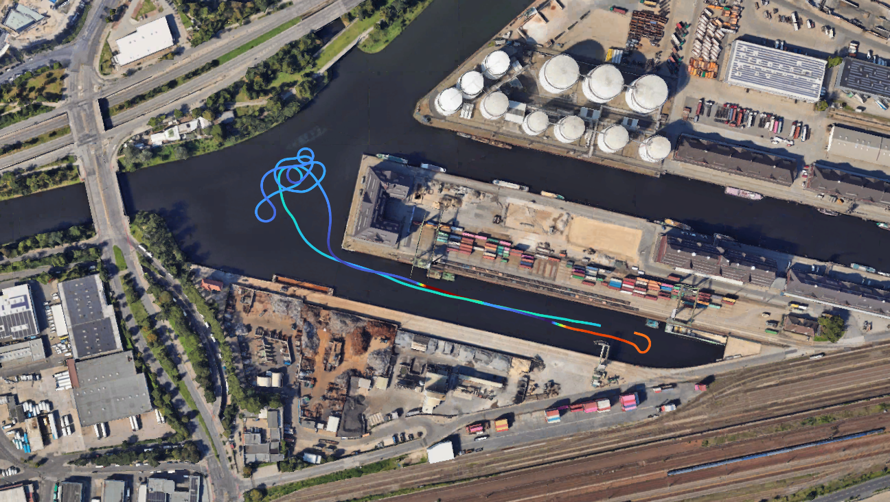
  &nbsp;
  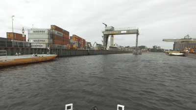
</p>

---

#### `berlin_01`

**Note:** This scene covers a port area with a loop-closure opportunity. Ouster LiDAR data is unavailable.

<p align="center">
  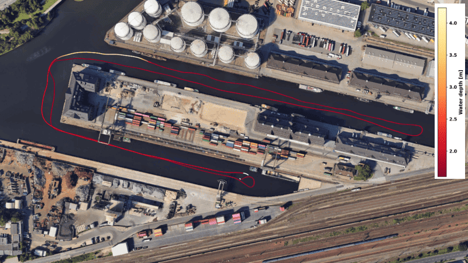
  &nbsp;
  
</p>

---

#### `berlin_02`

**Note:** This scene covers port and vegetation-dominated areas with a loop-closure opportunity, bridge passings, and vessel encounters. Ouster LiDAR data is unavailable.

<p align="center">
  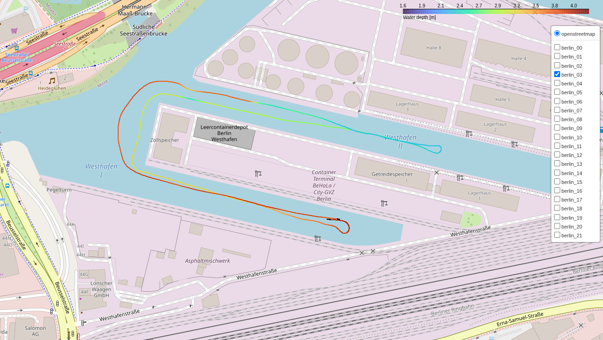
  &nbsp;
  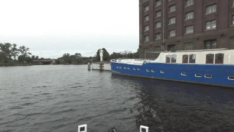
</p>

---

#### `berlin_03`

**Note:** This scene covers a forward and backward vegetation-dominated canal trajectory.

<p align="center">
  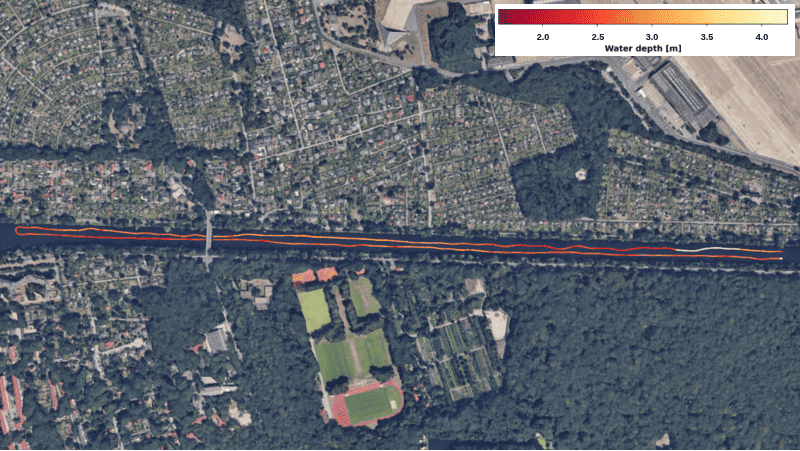
  &nbsp;
  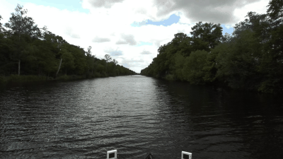
</p>

---

#### `berlin_04`

**Note:** This scene covers an urban area with bridge passings and vessel encounters.

<p align="center">
  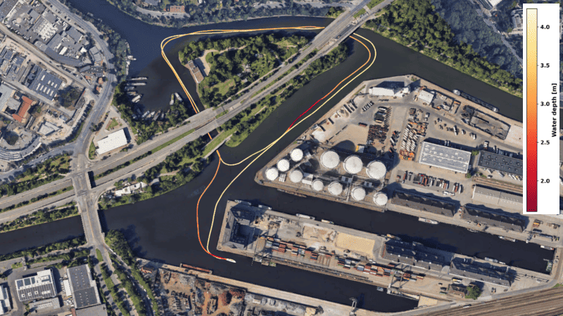
  &nbsp;
  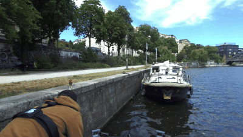
</p>

---

#### `berlin_05`

**Note:** This scene covers entry into and exit from a water lock, including a vessel encounter.

<p align="center">
  
  &nbsp;
  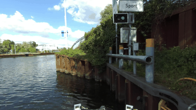
</p>

---

## Scene Details: Test Set

**Available data:** LiDAR, stereo camera, and IMU.

#### `berlin_06`

**Note:** This scene covers entry into and exit from a water lock.

<p align="center">
  
  &nbsp;
  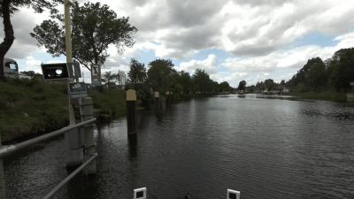
</p>

---

#### `berlin_07`

**Note:** This scene covers a port area with aggressive maneuvers by the data collecting platform and a clear loop-closure opportunity. Ouster LiDAR data is unavailable.

<p align="center">
  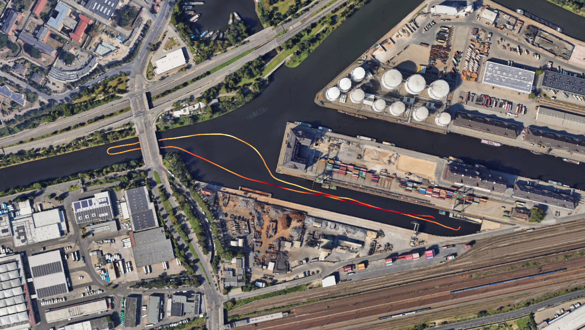
  &nbsp;
  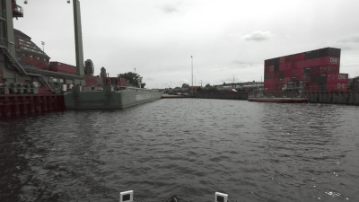
</p>

---

#### `berlin_08`

**Note:** This scene covers a port area with a loop-closure opportunity. Ouster LiDAR data is unavailable.

<p align="center">
  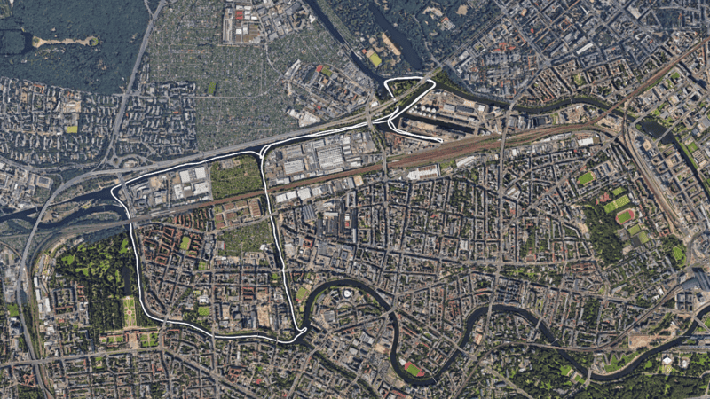
  &nbsp;
  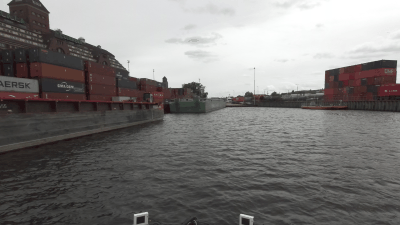
</p>

---

#### `berlin_09`

**Note:** This scene covers port and vegetation-dominated areas with a loop-closure opportunity, bridge passings, and vessel encounters. Ouster LiDAR data is unavailable.

<p align="center">
  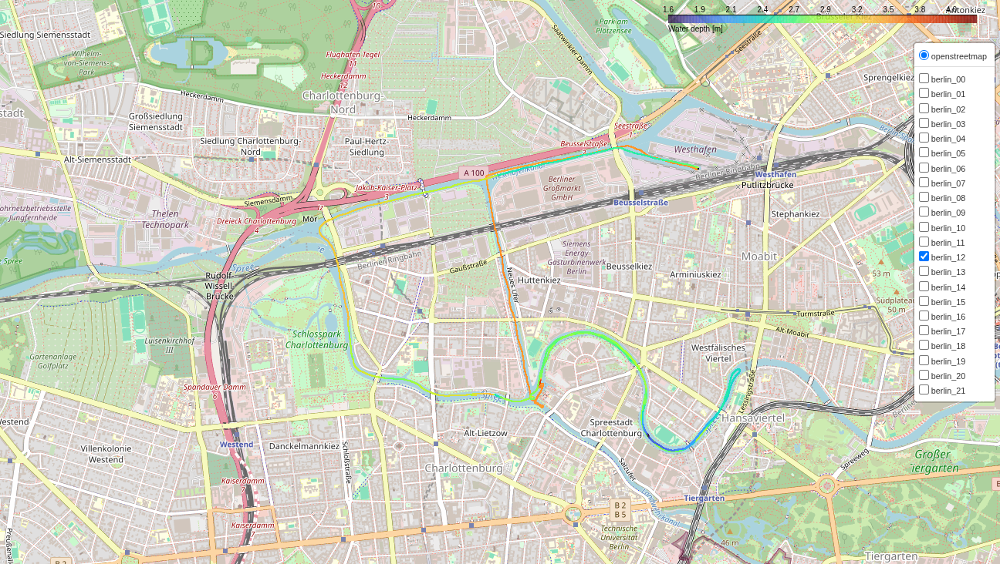
  &nbsp;
  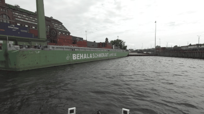
</p>

---

#### `berlin_10`

**Note:** This scene covers an urban area with multiple bridge passings and vessel encounters. Ouster LiDAR data is unavailable.

<p align="center">
  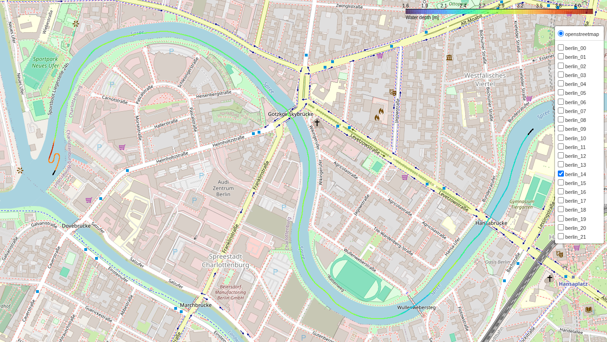
  &nbsp;
  
</p>

---

#### `berlin_11`

**Note:** This scene covers a port area with a loop-closure opportunity, bridge passings, and vessel encounters.

<p align="center">
  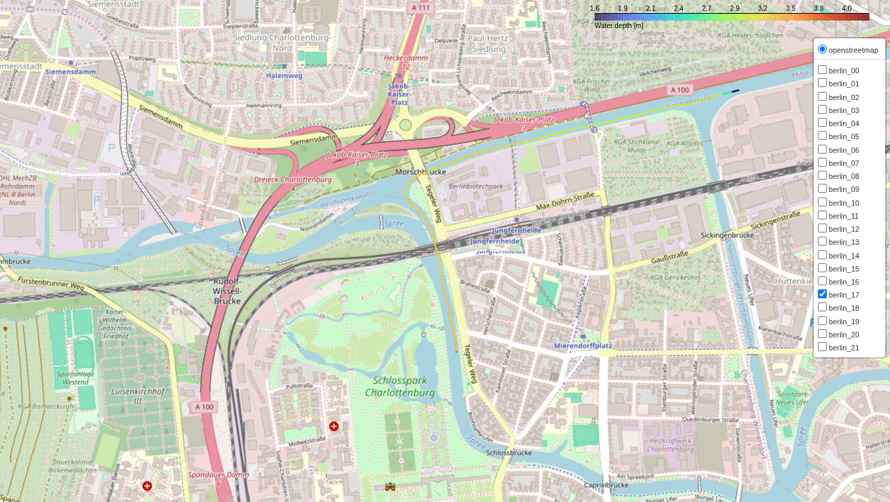
  &nbsp;
  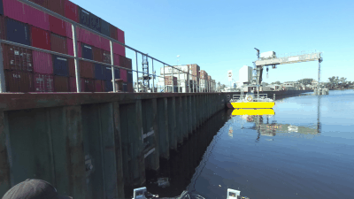
</p>

---

## Scene Details: Vision Set

**Available data:** Stereo camera and IMU.

#### `berlin_12`

**Note:** This scene covers a narrow channel with bridge passings and an encounter with vessels engaged in maintenance operations.

<p align="center">
  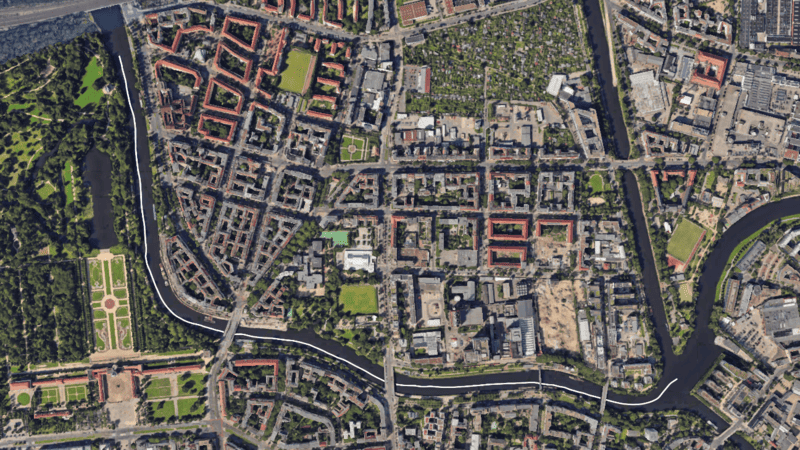
  &nbsp;
  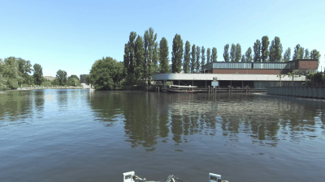
</p>

---

#### `berlin_13`

**Note:** This scene covers a narrow channel with multiple bridge passings and an encounter with vessels engaged in maintenance operations.

<p align="center">
  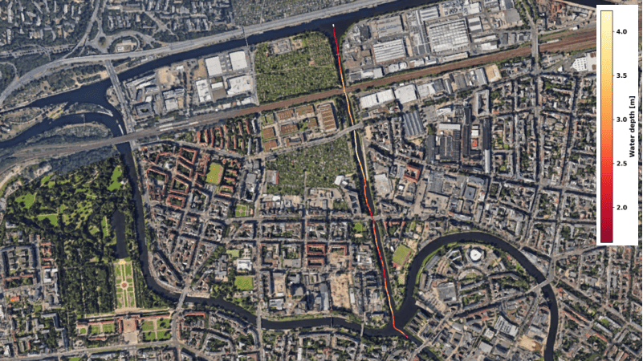
  &nbsp;
  
</p>

---

## Scene Details: LiDAR Set

**Available data:** LiDAR and IMU.

#### `berlin_14`

**Note:** This scene covers urban and vegetation-dominated areas along a wide channel, with bridge passings and vessel encounters.

<p align="center">
  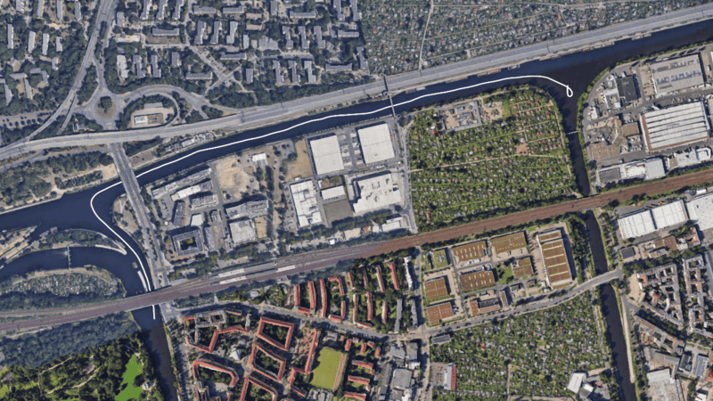
  &nbsp;
  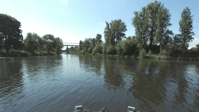
</p>

---

#### `berlin_15`

**Note:** This scene covers a vegetation-dominated area along a wide channel, with bridge passings and vessel encounters. Ouster and Livox LiDAR data are unavailable.

<p align="center">
  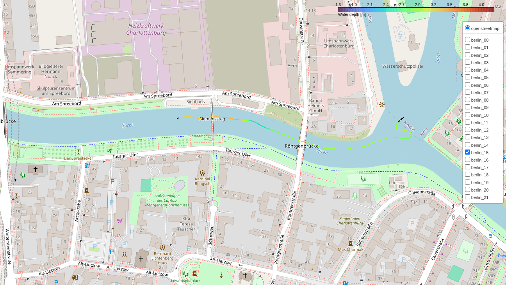
  &nbsp;
  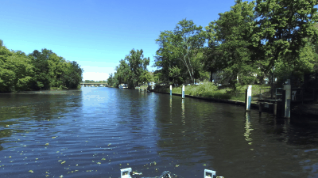
</p>

---

#### `berlin_16`

**Note:** This scene covers urban and vegetation-dominated areas with bridge passings and vessel encounters.

<p align="center">
  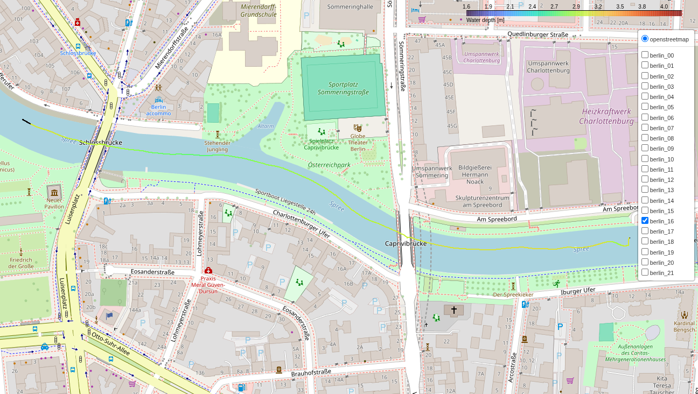
  &nbsp;
  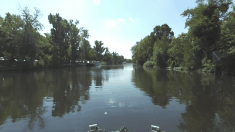
</p>

---

#### `berlin_17`

**Note:** This short scene covers urban and vegetation-dominated areas with vessel encounters, including bridge passings. Ouster LiDAR data is unavailable.

<p align="center">
  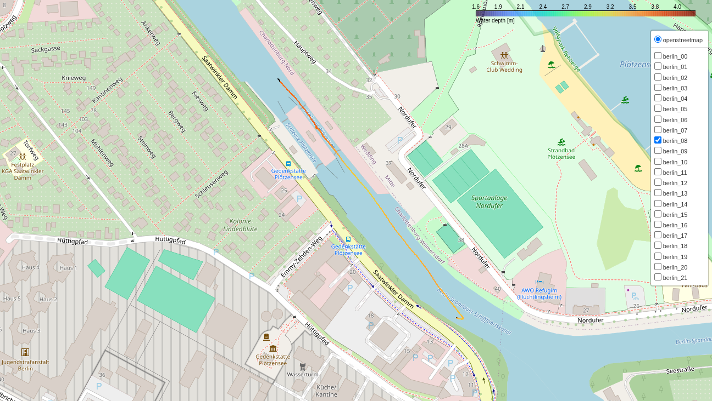
  &nbsp;
  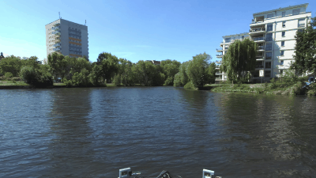
</p>

---

#### `berlin_18`

**Note:** This short scene covers urban and vegetation-dominated areas with vessel encounters, including bridge passings. Ouster LiDAR data is unavailable.

<p align="center">
  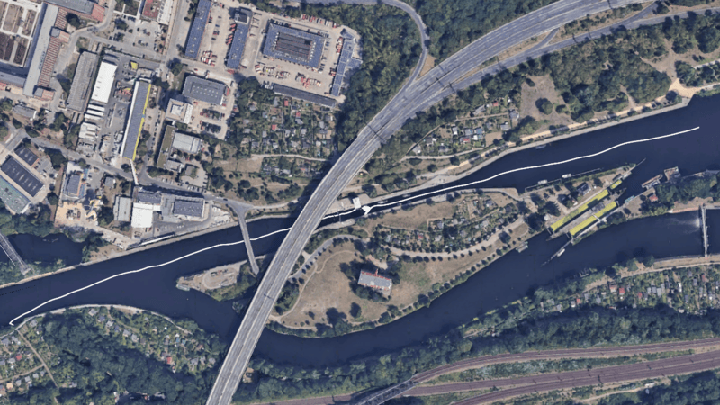
  &nbsp;
  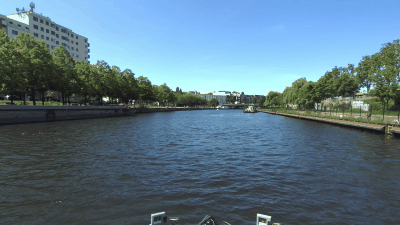
</p>

---

## Repeated-Environment Scene Groups

The following scenes cover overlapping environments at different times, supporting comparisons across recording sessions:

- `berlin_00` (Training) and `berlin_07` (Test)
- `berlin_01` (Training) and `berlin_08` (Test)
- `berlin_02` (Training), `berlin_09` (Test), and `berlin_11` (Test)
- `berlin_04` (Training) and `berlin_10` (Test)
- `berlin_12` and `berlin_13` (Vision)
- `berlin_14` and `berlin_15` (LiDAR)
- `berlin_16`, `berlin_17`, and `berlin_18` (LiDAR)


## SLAM Benchmark

We benchmark SLAM pipelines separately for each available LiDAR on training scenes 00–05 using Absolute Trajectory Error (ATE).

- **LIO:** [FAST-LIO2](https://github.com/hku-mars/FAST_LIO) · [iG-LIO](https://github.com/zijiechenrobotics/ig_lio) · [PV-LIO](https://github.com/HViktorTsoi/PV-LIO) · [LIO-SAM](https://github.com/TixiaoShan/LIO-SAM) · [Liorf](https://github.com/YJZLuckyBoy/liorf) · [SE(3)-LIO](https://github.com/url-kaist/se3-lio) · [BIEVR-LIO](https://github.com/ethz-asl/BIEVR-LIO) · [GenZ-LIO](https://github.com/cocel-postech/genz-lio) · [RKO-LIO](https://github.com/PRBonn/rko_lio)
- **LO:** [KISS-ICP](https://github.com/PRBonn/kiss-icp) · [GenZ-ICP](https://github.com/cocel-postech/genz-icp) · [FLOAM](https://github.com/wh200720041/floam) · [CT-ICP](https://github.com/jedeschaud/ct_icp) · [I2EKF-LO](https://github.com/YWL0720/I2EKF-LO)

### Velodyne LiDAR

#### ATE position [m], $\color{#2da44e}{\textsf{Best}}$ $\color{#218bff}{\textsf{Second best}}$

<!-- Explicit gray rule overlays keep horizontal separators visible in GitHub MathML. Thick rules span the full table; thin row separators start at the algorithm column. Widths match the current table contents. -->
$$
\begin{array}{llrrrrrr}
{\color{#6e7781}\rlap{\rule[1em]{28.45em}{2.4pt}}}{\color{#6e7781}\rlap{\rule[-0.35em]{28.45em}{2.4pt}}}\textsf{\textbf{Group}} & \textsf{\textbf{Algorithm}} & \hspace{0.625em}\textsf{\textbf{00}}\hspace{0.625em} & \hspace{0.625em}\textsf{\textbf{01}}\hspace{0.625em} & \hspace{0.625em}\textsf{\textbf{02}}\hspace{0.625em} & \hspace{0.875em}\textsf{\textbf{03}}\hspace{0.875em} & \hspace{0.875em}\textsf{\textbf{04}}\hspace{0.875em} & \hspace{0.625em}\textsf{\textbf{05}}\hspace{0.625em} \\
 & {\color{#6e7781}\rlap{\rule[-0.35em]{25.10em}{0.4pt}}}\textsf{FAST-LIO2} & \hspace{0.5em}\textsf{2.03} & \hspace{0.5em}\textsf{2.60} & \hspace{0.5em}\textsf{2.73} & \hspace{0.5em}\textsf{34.16} & \hspace{0.5em}\textsf{12.00} & \hspace{0.5em}\textsf{4.37} \\
 & {\color{#6e7781}\rlap{\rule[-0.35em]{25.10em}{0.4pt}}}\textsf{iG-LIO} & \hspace{0.5em}{\color{#218bff}\textsf{0.94}} & \hspace{0.5em}\textsf{2.56} & \hspace{0.5em}\textsf{2.78} & \hspace{1em}{\color{#218bff}\textsf{5.74}} & \hspace{0.5em}\textsf{10.87} & \hspace{0.5em}\textsf{1.61} \\
 & {\color{#6e7781}\rlap{\rule[-0.35em]{25.10em}{0.4pt}}}\textsf{PV-LIO} & \hspace{0.5em}\textsf{1.77} & \hspace{0.5em}{\color{#2da44e}\textsf{\textbf{1.31}}} & \hspace{0.5em}{\color{#218bff}\textsf{2.21}} & \hspace{1em}\textsf{7.47} & \hspace{1em}{\color{#2da44e}\textsf{\textbf{3.84}}} & \hspace{0.5em}{\color{#2da44e}\textsf{\textbf{0.92}}} \\
 & {\color{#6e7781}\rlap{\rule[-0.35em]{25.10em}{0.4pt}}}\textsf{LIO-SAM} & \hspace{0.5em}\textsf{1.08} & \hspace{0.5em}\textsf{3.26} & \hspace{0.5em}{\color{#2da44e}\textsf{\textbf{1.91}}} & \hspace{1em}{\color{#2da44e}\textsf{\textbf{4.70}}} & \hspace{1em}\textsf{5.44} & \hspace{0.5em}\textsf{4.90} \\
\textsf{\textbf{LIO}} & {\color{#6e7781}\rlap{\rule[-0.35em]{25.10em}{0.4pt}}}\textsf{Liorf} & \hspace{0.5em}\textsf{1.06} & \hspace{0.5em}\textsf{3.06} & \hspace{0.5em}\textsf{2.36} & \hspace{0.5em}\textsf{15.33} & \hspace{1em}\textsf{5.43} & \hspace{0.5em}\textsf{7.18} \\
 & {\color{#6e7781}\rlap{\rule[-0.35em]{25.10em}{0.4pt}}}\textsf{SE(3)-LIO} & \hspace{0.5em}\textsf{2.12} & \hspace{0.5em}{\color{#218bff}\textsf{2.40}} & \hspace{0.5em}\textsf{3.47} & \hspace{0.5em}\textsf{11.68} & \hspace{1em}\textsf{6.88} & \hspace{0.5em}{\color{#218bff}\textsf{1.16}} \\
 & {\color{#6e7781}\rlap{\rule[-0.35em]{25.10em}{0.4pt}}}\textsf{BIEVR-LIO} & \hspace{0.5em}{\color{#2da44e}\textsf{\textbf{0.88}}} & \textsf{12.59} & \hspace{0.5em}\textsf{4.07} & \hspace{0.5em}\textsf{11.87} & \hspace{1em}{\color{#218bff}\textsf{4.24}} & \hspace{0.5em}\textsf{2.31} \\
 & {\color{#6e7781}\rlap{\rule[-0.35em]{25.10em}{0.4pt}}}\textsf{GenZ-LIO} & \hspace{0.5em}\textsf{8.62} & \textsf{19.86} & \textsf{20.71} & \hspace{0.5em}\textsf{29.24} & \hspace{0.5em}\textsf{30.10} & \hspace{0.5em}\textsf{3.49} \\
{\color{#6e7781}\rlap{\rule[-0.35em]{28.45em}{2.4pt}}} & \textsf{RKO-LIO} & \textsf{15.95} & \textsf{53.36} & \textsf{27.90} & \hspace{0.5em}\textsf{77.19} & \hspace{0.5em}\textsf{32.89} & \textsf{54.74} \\
 & {\color{#6e7781}\rlap{\rule[-0.35em]{25.10em}{0.4pt}}}\textsf{KISS-ICP} & \textsf{19.75} & \textsf{54.01} & \textsf{31.35} & \textsf{107.43} & \hspace{0.5em}\textsf{37.12} & \textsf{23.45} \\
 & {\color{#6e7781}\rlap{\rule[-0.35em]{25.10em}{0.4pt}}}\textsf{GenZ-ICP} & \textsf{43.92} & \textsf{53.51} & \textsf{70.57} & \textsf{206.61} & \textsf{108.71} & \textsf{52.24} \\
\textsf{\textbf{LO}} & {\color{#6e7781}\rlap{\rule[-0.35em]{25.10em}{0.4pt}}}\textsf{FLOAM} & \textsf{12.29} & \textsf{16.88} & \hspace{0.5em}\textsf{5.73} & \hspace{0.5em}\textsf{46.51} & \hspace{0.5em}\textsf{19.13} & \hspace{0.5em}\textsf{8.35} \\
 & {\color{#6e7781}\rlap{\rule[-0.35em]{25.10em}{0.4pt}}}\textsf{CT-ICP} & \hspace{0.5em}\textsf{9.68} & \hspace{1.25em}\textsf{—} & \hspace{1.25em}\textsf{—} & \hspace{1.75em}\textsf{—} & \hspace{1.75em}\textsf{—} & \hspace{1.25em}\textsf{—} \\
{\color{#6e7781}\rlap{\rule[-0.35em]{28.45em}{2.4pt}}} & \textsf{I2EKF-LO} & \hspace{0.5em}\textsf{9.66} & \textsf{11.62} & \textsf{29.54} & \hspace{0.5em}\textsf{67.02} & \hspace{0.5em}\textsf{29.53} & \textsf{22.67} \\
\end{array}
$$

### Livox LiDAR

#### ATE position [m]

$$
\begin{array}{llrrrrrr}
{\color{#6e7781}\rlap{\rule[1em]{19.95em}{2.4pt}}}{\color{#6e7781}\rlap{\rule[-0.35em]{19.95em}{2.4pt}}}\textsf{\textbf{Group}} & \textsf{\textbf{Algorithm}} & \textsf{\textbf{00}} & \textsf{\textbf{01}} & \textsf{\textbf{02}} & \textsf{\textbf{03}} & \textsf{\textbf{04}} & \textsf{\textbf{05}}   \\
 & {\color{#6e7781}\rlap{\rule[-0.35em]{16.60em}{0.4pt}}}\textsf{FAST-LIO2} & \textsf{—} & \textsf{—} & \textsf{—} & \textsf{—} & \textsf{—} & \textsf{—}   \\
 & {\color{#6e7781}\rlap{\rule[-0.35em]{16.60em}{0.4pt}}}\textsf{iG-LIO} & \textsf{—} & \textsf{—} & \textsf{—} & \textsf{—} & \textsf{—} & \textsf{—}   \\
 & {\color{#6e7781}\rlap{\rule[-0.35em]{16.60em}{0.4pt}}}\textsf{PV-LIO} & \textsf{—} & \textsf{—} & \textsf{—} & \textsf{—} & \textsf{—} & \textsf{—}   \\
 & {\color{#6e7781}\rlap{\rule[-0.35em]{16.60em}{0.4pt}}}\textsf{LIO-SAM} & \textsf{—} & \textsf{—} & \textsf{—} & \textsf{—} & \textsf{—} & \textsf{—}   \\
\textsf{\textbf{LIO}} & {\color{#6e7781}\rlap{\rule[-0.35em]{16.60em}{0.4pt}}}\textsf{Liorf} & \textsf{—} & \textsf{—} & \textsf{—} & \textsf{—} & \textsf{—} & \textsf{—}   \\
 & {\color{#6e7781}\rlap{\rule[-0.35em]{16.60em}{0.4pt}}}\textsf{SE(3)-LIO} & \textsf{—} & \textsf{—} & \textsf{—} & \textsf{—} & \textsf{—} & \textsf{—}   \\
 & {\color{#6e7781}\rlap{\rule[-0.35em]{16.60em}{0.4pt}}}\textsf{BIEVR-LIO} & \textsf{—} & \textsf{—} & \textsf{—} & \textsf{—} & \textsf{—} & \textsf{—}   \\
 & {\color{#6e7781}\rlap{\rule[-0.35em]{16.60em}{0.4pt}}}\textsf{GenZ-LIO} & \textsf{—} & \textsf{—} & \textsf{—} & \textsf{—} & \textsf{—} & \textsf{—}   \\
{\color{#6e7781}\rlap{\rule[-0.35em]{19.95em}{2.4pt}}} & \textsf{RKO-LIO} & \textsf{—} & \textsf{—} & \textsf{—} & \textsf{—} & \textsf{—} & \textsf{—}   \\
 & {\color{#6e7781}\rlap{\rule[-0.35em]{16.60em}{0.4pt}}}\textsf{KISS-ICP} & \textsf{—} & \textsf{—} & \textsf{—} & \textsf{—} & \textsf{—} & \textsf{—}   \\
 & {\color{#6e7781}\rlap{\rule[-0.35em]{16.60em}{0.4pt}}}\textsf{GenZ-ICP} & \textsf{—} & \textsf{—} & \textsf{—} & \textsf{—} & \textsf{—} & \textsf{—}   \\
\textsf{\textbf{LO}} & {\color{#6e7781}\rlap{\rule[-0.35em]{16.60em}{0.4pt}}}\textsf{FLOAM} & \textsf{—} & \textsf{—} & \textsf{—} & \textsf{—} & \textsf{—} & \textsf{—}   \\
 & {\color{#6e7781}\rlap{\rule[-0.35em]{16.60em}{0.4pt}}}\textsf{CT-ICP} & \textsf{—} & \textsf{—} & \textsf{—} & \textsf{—} & \textsf{—} & \textsf{—}   \\
{\color{#6e7781}\rlap{\rule[-0.35em]{19.95em}{2.4pt}}} & \textsf{I2EKF-LO} & \textsf{—} & \textsf{—} & \textsf{—} & \textsf{—} & \textsf{—} & \textsf{—}   \\
\end{array}
$$

### Ouster LiDAR

**Note:** Ouster LiDAR data is unavailable for scenes 00–02, so these scenes are omitted from the table.

#### ATE position [m]

$$
\begin{array}{llrrr}
{\color{#6e7781}\rlap{\rule[1em]{14.55em}{2.4pt}}}{\color{#6e7781}\rlap{\rule[-0.35em]{14.55em}{2.4pt}}}\textsf{\textbf{Group}} & \textsf{\textbf{Algorithm}} & \textsf{\textbf{03}} & \textsf{\textbf{04}} & \textsf{\textbf{05}}   \\
 & {\color{#6e7781}\rlap{\rule[-0.35em]{11.20em}{0.4pt}}}\textsf{FAST-LIO2} & \textsf{—} & \textsf{—} & \textsf{—}   \\
 & {\color{#6e7781}\rlap{\rule[-0.35em]{11.20em}{0.4pt}}}\textsf{iG-LIO} & \textsf{—} & \textsf{—} & \textsf{—}   \\
 & {\color{#6e7781}\rlap{\rule[-0.35em]{11.20em}{0.4pt}}}\textsf{PV-LIO} & \textsf{—} & \textsf{—} & \textsf{—}   \\
 & {\color{#6e7781}\rlap{\rule[-0.35em]{11.20em}{0.4pt}}}\textsf{LIO-SAM} & \textsf{—} & \textsf{—} & \textsf{—}   \\
\textsf{\textbf{LIO}} & {\color{#6e7781}\rlap{\rule[-0.35em]{11.20em}{0.4pt}}}\textsf{Liorf} & \textsf{—} & \textsf{—} & \textsf{—}   \\
 & {\color{#6e7781}\rlap{\rule[-0.35em]{11.20em}{0.4pt}}}\textsf{SE(3)-LIO} & \textsf{—} & \textsf{—} & \textsf{—}   \\
 & {\color{#6e7781}\rlap{\rule[-0.35em]{11.20em}{0.4pt}}}\textsf{BIEVR-LIO} & \textsf{—} & \textsf{—} & \textsf{—}   \\
 & {\color{#6e7781}\rlap{\rule[-0.35em]{11.20em}{0.4pt}}}\textsf{GenZ-LIO} & \textsf{—} & \textsf{—} & \textsf{—}   \\
{\color{#6e7781}\rlap{\rule[-0.35em]{14.55em}{2.4pt}}} & \textsf{RKO-LIO} & \textsf{—} & \textsf{—} & \textsf{—}   \\
 & {\color{#6e7781}\rlap{\rule[-0.35em]{11.20em}{0.4pt}}}\textsf{KISS-ICP} & \textsf{—} & \textsf{—} & \textsf{—}   \\
 & {\color{#6e7781}\rlap{\rule[-0.35em]{11.20em}{0.4pt}}}\textsf{GenZ-ICP} & \textsf{—} & \textsf{—} & \textsf{—}   \\
\textsf{\textbf{LO}} & {\color{#6e7781}\rlap{\rule[-0.35em]{11.20em}{0.4pt}}}\textsf{FLOAM} & \textsf{—} & \textsf{—} & \textsf{—}   \\
 & {\color{#6e7781}\rlap{\rule[-0.35em]{11.20em}{0.4pt}}}\textsf{CT-ICP} & \textsf{—} & \textsf{—} & \textsf{—}   \\
{\color{#6e7781}\rlap{\rule[-0.35em]{14.55em}{2.4pt}}} & \textsf{I2EKF-LO} & \textsf{—} & \textsf{—} & \textsf{—}   \\
\end{array}
$$

---

### Example: LIO-SAM results on `berlin_00`, with and without GPS integration


## Segmentation Results

Qualitative semantic segmentation results: Each row shows the resized input image, ground truth, and predictions from U-Net Convolutional Network, Fully Convolutional Networks, and the Residual Network-based model across different scenes.

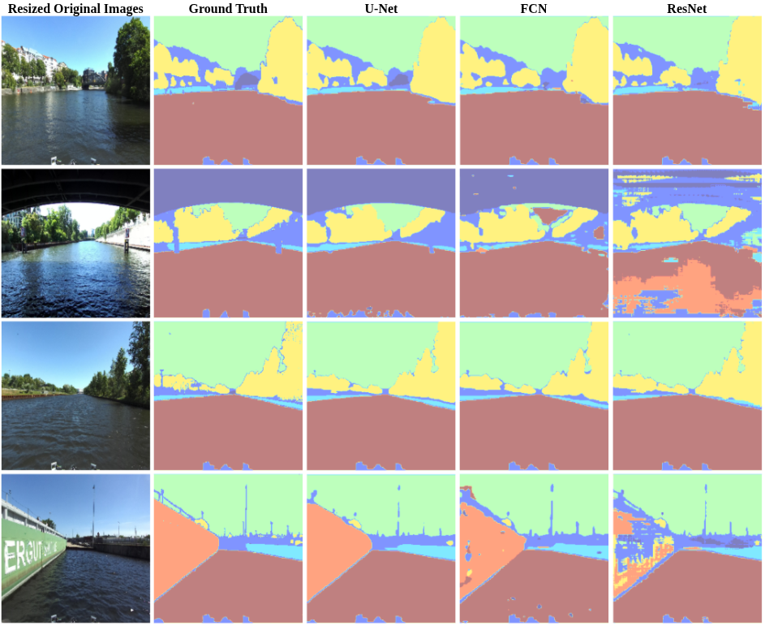

## GNSS RINEX Results

> <p style="color:red;">Add GNSS RINEX plots here</p>

## Acknowledgements

We thank all our colleagues who contributed during data collection campaign and for preparation of this dataset.

## License

This work is licensed under a Creative Commons Attribution-NonCommercial-ShareAlike 4.0 International License and is provided for non-commercial but academic use. If you are interested in using this dataset for commercial purposes, please contact us.
