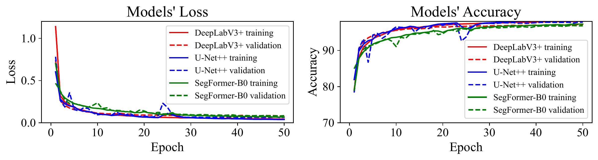
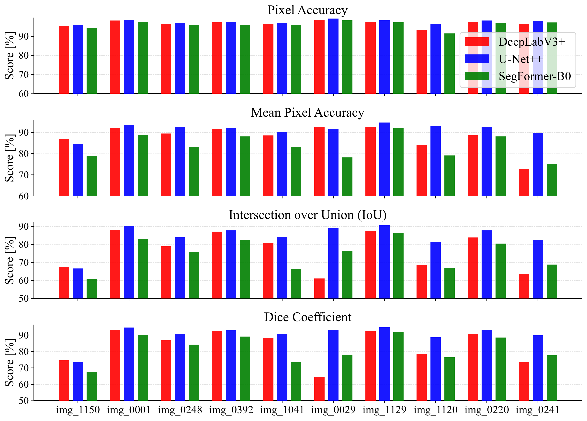
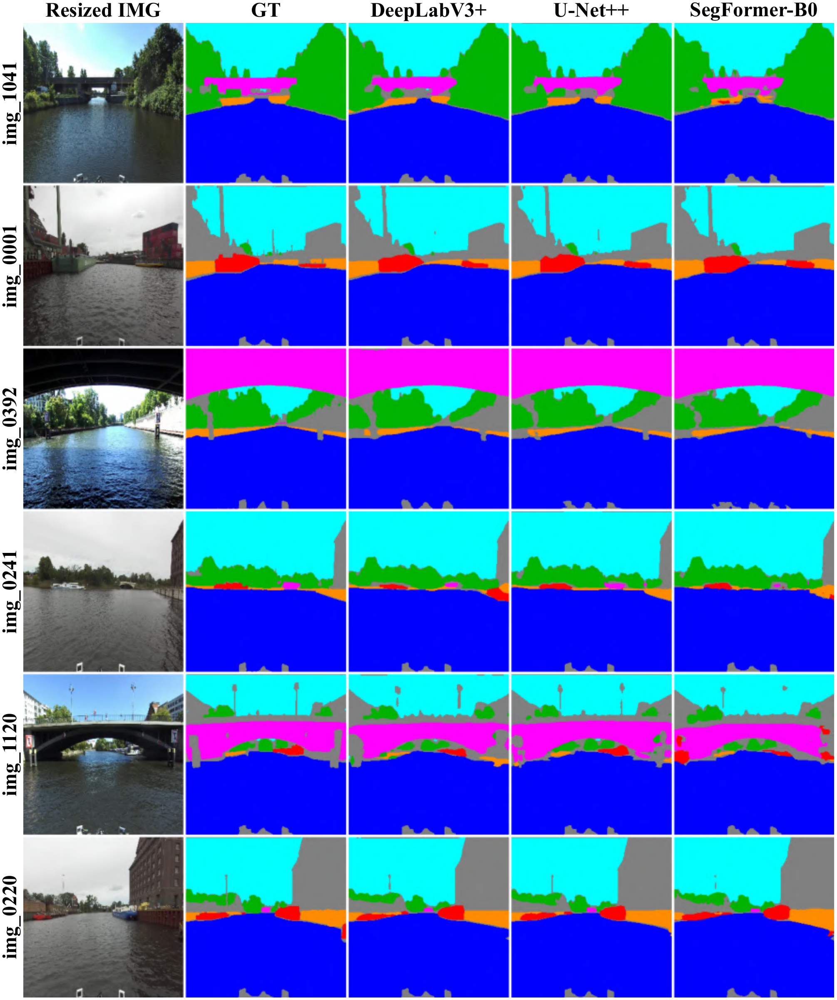

# Segmentation Benchmark

We benchmark **DeepLabV3+** and **U-Net++** with ResNet50 encoders, and **SegFormer-B0** with a MiT-B0 encoder. All models are trained from scratch.

**Training:** An 80%/10%/10% train/validation/test image split, with all recorded scenes represented in each subset; 256 × 256 images and masks; 50 epochs; Adam with an initial learning rate of 0.001 and unweighted cross-entropy loss.

## Training and Validation Curves

Loss and pixel accuracy over 50 epochs.

## Test Image Metrics

Pixel accuracy, mean pixel accuracy, mean intersection over union, and mean Dice coefficient for selected test images.

## Qualitative Results

Columns show the resized input, ground truth, and predictions from DeepLabV3+, U-Net++, and SegFormer-B0.

