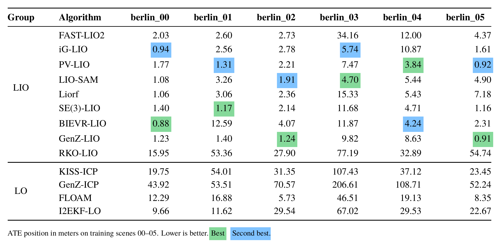

# SLAM Benchmark

We benchmark SLAM pipelines separately for each available LiDAR and the stereo camera on training scenes 00–05 using Absolute Trajectory Error (ATE).

- **LIO:** [FAST-LIO2](https://github.com/hku-mars/FAST_LIO) · [iG-LIO](https://github.com/zijiechenrobotics/ig_lio) · [PV-LIO](https://github.com/HViktorTsoi/PV-LIO) · [LIO-SAM](https://github.com/TixiaoShan/LIO-SAM) · [Liorf](https://github.com/YJZLuckyBoy/liorf) · [SE(3)-LIO](https://github.com/url-kaist/se3-lio) · [BIEVR-LIO](https://github.com/ethz-asl/BIEVR-LIO) · [GenZ-LIO](https://github.com/cocel-postech/genz-lio) · [RKO-LIO](https://github.com/PRBonn/rko_lio)
- **LO:** [KISS-ICP](https://github.com/PRBonn/kiss-icp) · [GenZ-ICP](https://github.com/cocel-postech/genz-icp) · [FLOAM](https://github.com/wh200720041/floam) · [I2EKF-LO](https://github.com/YWL0720/I2EKF-LO)
- **Stereo:** [OpenVINS](https://github.com/rpng/open_vins) · [VINS-Fusion](https://github.com/HKUST-Aerial-Robotics/VINS-Fusion) · [ORB-SLAM3](https://github.com/UZ-SLAMLab/ORB_SLAM3)

## Velodyne LiDAR

### ATE position [m], $\color{#2da44e}{\textsf{Best}}$ $\color{#218bff}{\textsf{Second best}}$

<!-- Explicit gray rule overlays keep horizontal separators visible in GitHub MathML. Thick rules span the full table; thin row separators start at the algorithm column. Widths match the current table contents. -->
$$
\begin{array}{llrrrrrr}
{\color{#6e7781}\rlap{\rule[1em]{28.45em}{2.4pt}}}{\color{#6e7781}\rlap{\rule[-0.35em]{28.45em}{2.4pt}}}\textsf{\textbf{Group}} & \textsf{\textbf{Algorithm}} & \hspace{0.625em}\textsf{\textbf{00}}\hspace{0.625em} & \hspace{0.625em}\textsf{\textbf{01}}\hspace{0.625em} & \hspace{0.625em}\textsf{\textbf{02}}\hspace{0.625em} & \hspace{0.875em}\textsf{\textbf{03}}\hspace{0.875em} & \hspace{0.875em}\textsf{\textbf{04}}\hspace{0.875em} & \hspace{0.625em}\textsf{\textbf{05}}\hspace{0.625em} \\
 & {\color{#6e7781}\rlap{\rule[-0.35em]{25.10em}{0.4pt}}}\textsf{FAST-LIO2} & \hspace{0.5em}\textsf{2.03} & \hspace{0.5em}\textsf{2.60} & \hspace{0.5em}\textsf{2.73} & \hspace{0.5em}\textsf{34.16} & \hspace{0.5em}\textsf{12.00} & \hspace{0.5em}\textsf{4.37} \\
 & {\color{#6e7781}\rlap{\rule[-0.35em]{25.10em}{0.4pt}}}\textsf{iG-LIO} & \hspace{0.5em}{\color{#218bff}\textsf{0.94}} & \hspace{0.5em}\textsf{2.56} & \hspace{0.5em}\textsf{2.78} & \hspace{1em}{\color{#218bff}\textsf{5.74}} & \hspace{0.5em}\textsf{10.87} & \hspace{0.5em}\textsf{1.61} \\
 & {\color{#6e7781}\rlap{\rule[-0.35em]{25.10em}{0.4pt}}}\textsf{PV-LIO} & \hspace{0.5em}\textsf{1.77} & \hspace{0.5em}{\color{#218bff}\textsf{1.31}} & \hspace{0.5em}\textsf{2.21} & \hspace{1em}\textsf{7.47} & \hspace{1em}{\color{#2da44e}\textsf{\textbf{3.84}}} & \hspace{0.5em}{\color{#218bff}\textsf{0.92}} \\
 & {\color{#6e7781}\rlap{\rule[-0.35em]{25.10em}{0.4pt}}}\textsf{LIO-SAM} & \hspace{0.5em}\textsf{1.08} & \hspace{0.5em}\textsf{3.26} & \hspace{0.5em}{\color{#218bff}\textsf{1.91}} & \hspace{1em}{\color{#2da44e}\textsf{\textbf{4.70}}} & \hspace{1em}\textsf{5.44} & \hspace{0.5em}\textsf{4.90} \\
\textsf{\textbf{LIO}} & {\color{#6e7781}\rlap{\rule[-0.35em]{25.10em}{0.4pt}}}\textsf{Liorf} & \hspace{0.5em}\textsf{1.06} & \hspace{0.5em}\textsf{3.06} & \hspace{0.5em}\textsf{2.36} & \hspace{0.5em}\textsf{15.33} & \hspace{1em}\textsf{5.43} & \hspace{0.5em}\textsf{7.18} \\
 & {\color{#6e7781}\rlap{\rule[-0.35em]{25.10em}{0.4pt}}}\textsf{SE(3)-LIO} & \hspace{0.5em}\textsf{1.40} & \hspace{0.5em}{\color{#2da44e}\textsf{\textbf{1.17}}} & \hspace{0.5em}\textsf{2.14} & \hspace{0.5em}\textsf{11.68} & \hspace{1em}\textsf{4.71} & \hspace{0.5em}\textsf{1.16} \\
 & {\color{#6e7781}\rlap{\rule[-0.35em]{25.10em}{0.4pt}}}\textsf{BIEVR-LIO} & \hspace{0.5em}{\color{#2da44e}\textsf{\textbf{0.88}}} & \textsf{12.59} & \hspace{0.5em}\textsf{4.07} & \hspace{0.5em}\textsf{11.87} & \hspace{1em}{\color{#218bff}\textsf{4.24}} & \hspace{0.5em}\textsf{2.31} \\
 & {\color{#6e7781}\rlap{\rule[-0.35em]{25.10em}{0.4pt}}}\textsf{GenZ-LIO} & \hspace{0.5em}\textsf{1.23} & \hspace{0.5em}\textsf{1.40} & \hspace{0.5em}{\color{#2da44e}\textsf{\textbf{1.24}}} & \hspace{1em}\textsf{9.82} & \hspace{1em}\textsf{8.63} & \hspace{0.5em}{\color{#2da44e}\textsf{\textbf{0.91}}} \\
{\color{#6e7781}\rlap{\rule[-0.35em]{28.45em}{2.4pt}}} & \textsf{RKO-LIO} & \textsf{15.95} & \textsf{53.36} & \textsf{27.90} & \hspace{0.5em}\textsf{77.19} & \hspace{0.5em}\textsf{32.89} & \textsf{54.74} \\
 & {\color{#6e7781}\rlap{\rule[-0.35em]{25.10em}{0.4pt}}}\textsf{KISS-ICP} & \textsf{19.75} & \textsf{54.01} & \textsf{31.35} & \textsf{107.43} & \hspace{0.5em}\textsf{37.12} & \textsf{23.45} \\
 & {\color{#6e7781}\rlap{\rule[-0.35em]{25.10em}{0.4pt}}}\textsf{GenZ-ICP} & \textsf{43.92} & \textsf{53.51} & \textsf{70.57} & \textsf{206.61} & \textsf{108.71} & \textsf{52.24} \\
\textsf{\textbf{LO}} & {\color{#6e7781}\rlap{\rule[-0.35em]{25.10em}{0.4pt}}}\textsf{FLOAM} & \textsf{12.29} & \textsf{16.88} & \hspace{0.5em}\textsf{5.73} & \hspace{0.5em}\textsf{46.51} & \hspace{0.5em}\textsf{19.13} & \hspace{0.5em}\textsf{8.35} \\
{\color{#6e7781}\rlap{\rule[-0.35em]{28.45em}{2.4pt}}} & \textsf{I2EKF-LO} & \hspace{0.5em}\textsf{9.66} & \textsf{11.62} & \textsf{29.54} & \hspace{0.5em}\textsf{67.02} & \hspace{0.5em}\textsf{29.53} & \textsf{22.67} \\
\end{array}
$$

### Velodyne LiDAR: ATE position [m]

[PDF](../figures/velodyne_ate_robotics.pdf) · [LaTeX source](velodyne_ate_robotics.tex)

## Livox LiDAR

### ATE position [m], $\color{#2da44e}{\textsf{Best}}$ $\color{#218bff}{\textsf{Second best}}$

$$
\begin{array}{llrrrrrr}
{\color{#6e7781}\rlap{\rule[1em]{26.45em}{2.4pt}}}{\color{#6e7781}\rlap{\rule[-0.35em]{26.45em}{2.4pt}}}\textsf{\textbf{Group}} & \textsf{\textbf{Algorithm}} & \hspace{0.625em}\textsf{\textbf{00}}\hspace{0.625em} & \hspace{0.375em}\textsf{\textbf{01}}\hspace{0.375em} & \hspace{0.625em}\textsf{\textbf{02}}\hspace{0.625em} & \hspace{0.625em}\textsf{\textbf{03}}\hspace{0.625em} & \hspace{0.625em}\textsf{\textbf{04}}\hspace{0.625em} & \hspace{0.375em}\textsf{\textbf{05}}\hspace{0.375em} \\
 & {\color{#6e7781}\rlap{\rule[-0.35em]{23.10em}{0.4pt}}}\textsf{FAST-LIO2} & \textsf{20.74} & \textsf{1.07} & \hspace{0.5em}\textsf{4.05} & \hspace{0.5em}\textsf{4.08} & \hspace{0.5em}{\color{#218bff}\textsf{2.05}} & \textsf{1.62} \\
 & {\color{#6e7781}\rlap{\rule[-0.35em]{23.10em}{0.4pt}}}\textsf{iG-LIO} & \textsf{21.45} & \textsf{2.38} & \hspace{0.5em}{\color{#2da44e}\textsf{\textbf{1.38}}} & \hspace{0.5em}{\color{#2da44e}\textsf{\textbf{1.40}}} & \hspace{0.5em}{\color{#2da44e}\textsf{\textbf{1.62}}} & {\color{#2da44e}\textsf{\textbf{0.66}}} \\
\textsf{\textbf{LIO}} & {\color{#6e7781}\rlap{\rule[-0.35em]{23.10em}{0.4pt}}}\textsf{SE(3)-LIO} & \hspace{0.5em}{\color{#2da44e}\textsf{\textbf{1.50}}} & \textsf{1.66} & \hspace{0.5em}\textsf{3.88} & \hspace{0.5em}\textsf{6.94} & \hspace{0.5em}\textsf{2.95} & \textsf{3.70} \\
 & {\color{#6e7781}\rlap{\rule[-0.35em]{23.10em}{0.4pt}}}\textsf{BIEVR-LIO} & \textsf{21.70} & {\color{#218bff}\textsf{1.03}} & \textsf{30.75} & \hspace{0.5em}{\color{#218bff}\textsf{1.77}} & \textsf{13.49} & \textsf{0.73} \\
 & {\color{#6e7781}\rlap{\rule[-0.35em]{23.10em}{0.4pt}}}\textsf{GenZ-LIO} & {\color{#218bff}\textsf{14.79}} & \textsf{1.27} & \hspace{0.5em}\textsf{4.06} & \textsf{12.17} & \hspace{0.5em}\textsf{3.48} & \textsf{1.86} \\
{\color{#6e7781}\rlap{\rule[-0.35em]{26.45em}{2.4pt}}} & \textsf{RKO-LIO} & \textsf{21.61} & \textsf{1.61} & \hspace{0.5em}\textsf{2.71} & \hspace{0.5em}\textsf{5.98} & \textsf{26.28} & \textsf{5.44} \\
\textsf{\textbf{LO}} & {\color{#6e7781}\rlap{\rule[-0.35em]{23.10em}{0.4pt}}}\textsf{KISS-ICP} & \textsf{20.94} & {\color{#2da44e}\textsf{\textbf{0.90}}} & \hspace{0.5em}\textsf{3.54} & \textsf{26.25} & \hspace{0.5em}\textsf{7.07} & \textsf{0.72} \\
{\color{#6e7781}\rlap{\rule[-0.35em]{26.45em}{2.4pt}}} & \textsf{GenZ-ICP} & \textsf{21.46} & \textsf{1.48} & \hspace{0.5em}{\color{#218bff}\textsf{2.32}} & \hspace{0.5em}\textsf{6.64} & \hspace{0.5em}\textsf{9.59} & {\color{#218bff}\textsf{0.69}} \\
\end{array}
$$

## Ouster LiDAR

**Note:** Ouster LiDAR data is unavailable for scenes 00–02, so these scenes are omitted from the table.

### ATE position [m], $\color{#2da44e}{\textsf{Best}}$ $\color{#218bff}{\textsf{Second best}}$

$$
\begin{array}{llrrr}
{\color{#6e7781}\rlap{\rule[1em]{19.30em}{2.4pt}}}{\color{#6e7781}\rlap{\rule[-0.35em]{19.30em}{2.4pt}}}\textsf{\textbf{Group}} & \textsf{\textbf{Algorithm}} & \hspace{0.625em}\textsf{\textbf{03}}\hspace{0.625em} & \hspace{0.875em}\textsf{\textbf{04}}\hspace{0.875em} & \hspace{0.875em}\textsf{\textbf{05}}\hspace{0.875em} \\
 & {\color{#6e7781}\rlap{\rule[-0.35em]{15.95em}{0.4pt}}}\textsf{FAST-LIO2} & \textsf{19.78} & \hspace{0.5em}\textsf{19.97} & \textsf{288.55} \\
 & {\color{#6e7781}\rlap{\rule[-0.35em]{15.95em}{0.4pt}}}\textsf{iG-LIO} & {\color{#2da44e}\textsf{\textbf{10.57}}} & \hspace{0.5em}\textsf{18.77} & \hspace{1em}{\color{#218bff}\textsf{1.05}} \\
\textsf{\textbf{LIO}} & {\color{#6e7781}\rlap{\rule[-0.35em]{15.95em}{0.4pt}}}\textsf{SE(3)-LIO} & {\color{#218bff}\textsf{13.12}} & \hspace{0.5em}{\color{#218bff}\textsf{10.38}} & \hspace{1em}\textsf{1.37} \\
 & {\color{#6e7781}\rlap{\rule[-0.35em]{15.95em}{0.4pt}}}\textsf{BIEVR-LIO} & \textsf{14.87} & \textsf{189.10} & \hspace{1em}\textsf{2.14} \\
 & {\color{#6e7781}\rlap{\rule[-0.35em]{15.95em}{0.4pt}}}\textsf{GenZ-LIO} & \textsf{48.57} & \hspace{0.5em}\textsf{41.45} & \hspace{1em}\textsf{2.01} \\
{\color{#6e7781}\rlap{\rule[-0.35em]{19.30em}{2.4pt}}} & \textsf{RKO-LIO} & \textsf{24.69} & \hspace{0.5em}\textsf{43.26} & \hspace{1em}{\color{#2da44e}\textsf{\textbf{0.97}}} \\
\textsf{\textbf{LO}} & {\color{#6e7781}\rlap{\rule[-0.35em]{15.95em}{0.4pt}}}\textsf{KISS-ICP} & \textsf{25.46} & \hspace{0.5em}\textsf{28.44} & \hspace{1em}\textsf{3.58} \\
{\color{#6e7781}\rlap{\rule[-0.35em]{19.30em}{2.4pt}}} & \textsf{GenZ-ICP} & \textsf{13.94} & \hspace{1em}{\color{#2da44e}\textsf{\textbf{9.26}}} & \hspace{1em}\textsf{1.52} \\
\end{array}
$$

## Stereo Camera

### ATE position [m], $\color{#2da44e}{\textsf{Best}}$ $\color{#218bff}{\textsf{Second best}}$

$$
\begin{array}{lrrrrrr}
{\color{#6e7781}\rlap{\rule[1em]{27.60em}{2.4pt}}}{\color{#6e7781}\rlap{\rule[-0.35em]{27.60em}{2.4pt}}}\textsf{\textbf{Algorithm}} & \hspace{0.625em}\textsf{\textbf{00}}\hspace{0.625em} & \hspace{0.875em}\textsf{\textbf{01}}\hspace{0.875em} & \hspace{0.875em}\textsf{\textbf{02}}\hspace{0.875em} & \hspace{0.875em}\textsf{\textbf{03}}\hspace{0.875em} & \hspace{0.875em}\textsf{\textbf{04}}\hspace{0.875em} & \hspace{0.875em}\textsf{\textbf{05}}\hspace{0.875em} \\
{\color{#6e7781}\rlap{\rule[-0.35em]{27.60em}{0.4pt}}}\textsf{OpenVINS} & \textsf{95.14} & \textsf{149.77} & \hspace{0.5em}{\color{#218bff}\textsf{93.42}} & \textsf{395.75} & \hspace{0.5em}{\color{#2da44e}\textsf{\textbf{48.78}}} & \hspace{0.5em}{\color{#218bff}\textsf{86.91}} \\
{\color{#6e7781}\rlap{\rule[-0.35em]{27.60em}{0.4pt}}}\textsf{VINS-Fusion} & {\color{#218bff}\textsf{77.59}} & \hspace{0.5em}{\color{#218bff}\textsf{77.64}} & \textsf{150.07} & {\color{#2da44e}\textsf{\textbf{141.51}}} & {\color{#218bff}\textsf{121.48}} & \hspace{0.5em}{\color{#2da44e}\textsf{\textbf{84.18}}} \\
{\color{#6e7781}\rlap{\rule[-0.35em]{27.60em}{2.4pt}}}\textsf{ORB-SLAM3} & {\color{#2da44e}\textsf{\textbf{52.86}}} & \hspace{0.5em}{\color{#2da44e}\textsf{\textbf{25.15}}} & \hspace{0.5em}{\color{#2da44e}\textsf{\textbf{67.44}}} & {\color{#218bff}\textsf{318.82}} & \textsf{155.76} & \textsf{105.22} \\
\end{array}
$$

---

## LIO-SAM on `berlin_00`: With and Without GPS Integration

